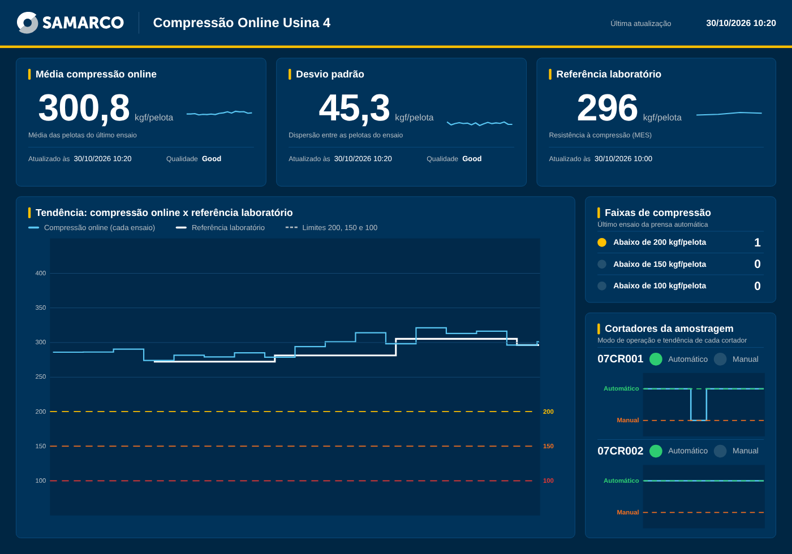
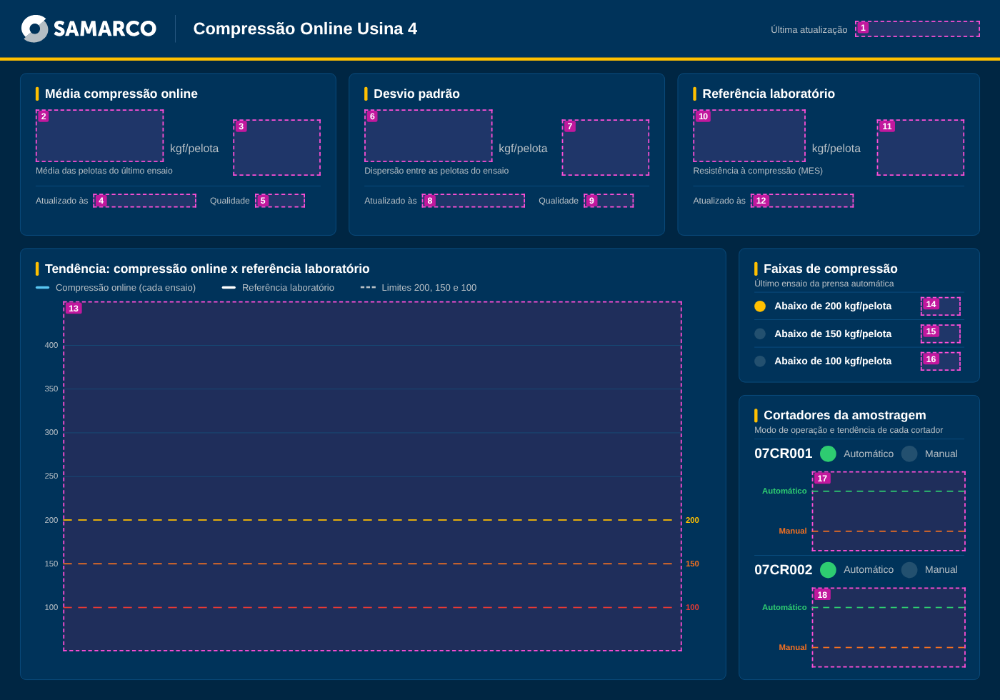

# Passo a passo: tela Compressão Online Usina 4 no Aspen (versão 8)

**Tela:** Compressão Online Usina 4, padrão visual Samarco: média e desvio padrão da prensa automática, referência do laboratório, faixas de compressão e cortadores da amostragem com tendência

**Resultado esperado:** igual a `tela_exemplo_normal.png`

**Tempo estimado:** 20 minutos

## O que vem pronto no arquivo

O arquivo `LCE_Compressao_Online_Usina4.atgraphic` segue o mesmo formato da versão que já abriu no seu PIMS. Tudo é objeto nativo do Aspen e não perde nitidez ao maximizar. Não há mais tags calculadas: a tela usa só as tags que já existem.

| Conteúdo | Quantidade |
|---|---|
| Painéis, linhas, limites tracejados e logotipo oficial em polígonos | 227 |
| Textos fixos | 47 |
| Campos de dados ligados às tags | 12 |
| Tendências com penas e escala definidas | 6 |
| Lâmpadas animadas (cortadores e faixas de compressão) | 7 |

## Parte A. Abrir

**A1.** Copie `LCE_Compressao_Online_Usina4.atgraphic` para a pasta de rede das telas do laboratório. A versão anterior (`LCE_Compressao_Pelotas_Prensa01`) pode ser apagada depois que esta estiver conferida.

**A2.** Abra no **Aspen Process Graphics Editor**, compare com `tela_exemplo_normal.png` e maximize.

**Se der erro ao abrir:** tente `teste_minimo.atgraphic` e me envie a captura da mensagem, dizendo se o arquivo de teste abriu.

## Parte B. Ajustes nos campos (no editor)

**B1. Atributo de data e hora.** Os campos abaixo vêm com o atributo `VAL` e mostram um número no lugar da hora. Dê duplo clique em cada um e troque `VAL` pelo atributo de data e hora da lista:

| Objeto | Campo |
|---|---|
| 1 | Última atualização (cabeçalho) |
| 4 | Média compressão online: atualizado às |
| 8 | Desvio padrão: atualizado às |
| 12 | Referência laboratório: atualizado às |

Dica: depois de achar o atributo certo no objeto 1, me diga o nome. Na próxima versão ele já vem configurado em todos.

**B2. Atributo de qualidade** nos objetos 5 e 9 (qualidade da média e do desvio padrão), com a regra de cor: `Good` em branco e qualquer outro texto em laranja (RGB 243, 112, 33).

**B3. Mapa dos discretos.** Os objetos 14, 15 e 16 (faixas de compressão) e as três lâmpadas ao lado deles usam o mapa `IP_DISCRETEMAP`, o mesmo da versão anterior, que funcionou. Nada a fazer, a menos que apareça erro.

## Parte C. Tendências

| Objeto | Penas | Escala |
|---|---|---|
| 3 (minitendência da média) | `307-GI-001` | 0 a 500 |
| 7 (minitendência do desvio padrão) | `307-GI-002` | 0 a 150 |
| 11 (minitendência do laboratório) | `M4710050020-0031-HHLFU` | 0 a 500 |
| 13 (tendência principal) | `307-GI-001` (compressão online, azul claro) e `M4710050020-0031-HHLFU` (referência laboratório, branca) | 50 a 450 nas duas |
| 17 e 18 (cortadores) | `U04-07CR001` e `U04-07CR002` (mapa `IP_PIDMAP03`) | 8 a 40 |

**C1.** Na barra de tempo, embaixo de cada tendência, use **`8:00:00`** na principal e **`24:00:00`** nas dos cortadores (ou o período que preferir).

**C2.** Os números de 100 a 400, as linhas de 200, 150 e 100 e as linhas Automático e Manual dos cortadores são parte fixa da tela. **Não altere a escala das penas**, senão a linha deixa de coincidir com as referências.

## Parte D. Lâmpadas (já prontas)

| Lâmpadas | Tag | Acende quando |
|---|---|---|
| 07CR001 e 07CR002, Automático | `U04-07CR001`, `U04-07CR002` (mapa `IP_PIDMAP03`) | valor 32, em verde |
| 07CR001 e 07CR002, Manual | mesmas tags | valor 16, em laranja |
| Faixas abaixo de 200, 150 e 100 kgf/pelota | `307-QI-003`, `307-QI-002`, `307-QI-001` | valor maior que zero, na cor da faixa |

## Parte E. Salvar

**E1.** **Arquivo > Salvar**. Abra no Process Explorer e maximize para conferir.

## Parte F. Problemas comuns

| Problema | Solução |
|---|---|
| Erro ao abrir | Tente `teste_minimo.atgraphic` e envie a captura (Parte A) |
| Hora mostra um número | Parte B1 |
| Campos e tendências sem dados novos, em todas as telas | Problema no PIMS ou na coleta da tag, não na tela: confira a mesma tag no Process Explorer ou na tela PQ US04 |
| Linha do cortador fora das referências Automático e Manual | Volte a escala para 8 a 40 (Parte C) |
| Escala da tendência principal diferente | Volte para 50 a 450 (Parte C) |

## Anexo. Fichas dos objetos dinâmicos

Referência caso algum objeto precise ser refeito à mão. Posições em unidades da tela de 50 x 35.

### Objeto 1: Última atualização (cabeçalho)

| Propriedade | Valor |
|---|---|
| Ferramenta | Campo de dados |
| Posição em unidades (X ; Y) | 42,75 ; 1,03 |
| Tamanho em unidades (largura ; altura) | 6,25 ; 0,81 |
| Tag | `307-GI-001` |
| Mapa | `IP_ANALOGMAP` |
| Atributo | `VAL` no arquivo: **trocar pelo atributo de data e hora** (Parte B) |
| Fonte | Arial negrito, já definida no arquivo |
| Alinhamento | Direita |
| Cor do texto | RGB 255, 255, 255 |
| Cor de fundo | RGB 0, 51, 90 (ou transparente), sem borda |
| Formato | dd/mm/aaaa hh:mm:ss |
| Regra de cor | Nenhuma |

### Objeto 2: Média compressão online: valor

| Propriedade | Valor |
|---|---|
| Ferramenta | Campo de dados |
| Posição em unidades (X ; Y) | 1,78 ; 5,47 |
| Tamanho em unidades (largura ; altura) | 6,41 ; 2,63 |
| Tag | `307-GI-001` |
| Mapa | `IP_ANALOGMAP` |
| Atributo | `VAL` |
| Fonte | Arial negrito, já definida no arquivo |
| Alinhamento | Direita |
| Cor do texto | RGB 255, 255, 255 |
| Cor de fundo | RGB 0, 51, 90 (ou transparente), sem borda |
| Formato | 1 casa decimal (0,0) |
| Regra de cor | Nenhuma |

### Objeto 3: Média compressão online: minitendência

| Propriedade | Valor |
|---|---|
| Ferramenta | Tendência (plot) |
| Posição em unidades (X ; Y) | 11,66 ; 5,97 |
| Tamanho em unidades (largura ; altura) | 4,38 ; 2,81 |
| Observação | Já vem pronta no arquivo, escala 0 a 500. Ver Parte C. |

### Objeto 4: Média compressão online: atualizado às

| Propriedade | Valor |
|---|---|
| Ferramenta | Campo de dados |
| Posição em unidades (X ; Y) | 4,66 ; 9,69 |
| Tamanho em unidades (largura ; altura) | 5,16 ; 0,69 |
| Tag | `307-GI-001` |
| Mapa | `IP_ANALOGMAP` |
| Atributo | `VAL` no arquivo: **trocar pelo atributo de data e hora** (Parte B) |
| Fonte | Arial, já definida no arquivo |
| Alinhamento | Esquerda |
| Cor do texto | RGB 255, 255, 255 |
| Cor de fundo | RGB 0, 51, 90 (ou transparente), sem borda |
| Formato | dd/mm/aaaa hh:mm:ss |
| Regra de cor | Nenhuma |

### Objeto 5: Média compressão online: qualidade

| Propriedade | Valor |
|---|---|
| Ferramenta | Campo de dados |
| Posição em unidades (X ; Y) | 12,75 ; 9,69 |
| Tamanho em unidades (largura ; altura) | 2,50 ; 0,69 |
| Tag | `307-GI-001` |
| Mapa | `IP_ANALOGMAP` |
| Atributo | `VAL` no arquivo: **trocar pelo atributo de qualidade** (Parte B) |
| Fonte | Arial negrito, já definida no arquivo |
| Alinhamento | Esquerda |
| Cor do texto | RGB 255, 255, 255 |
| Cor de fundo | RGB 0, 51, 90 (ou transparente), sem borda |
| Formato | Texto |
| Regra de cor | Texto igual a `Good`: RGB 255, 255, 255. Qualquer outro texto: RGB 243, 112, 33 |

### Objeto 6: Desvio padrão: valor

| Propriedade | Valor |
|---|---|
| Ferramenta | Campo de dados |
| Posição em unidades (X ; Y) | 18,22 ; 5,47 |
| Tamanho em unidades (largura ; altura) | 6,41 ; 2,63 |
| Tag | `307-GI-002` |
| Mapa | `IP_ANALOGMAP` |
| Atributo | `VAL` |
| Fonte | Arial negrito, já definida no arquivo |
| Alinhamento | Direita |
| Cor do texto | RGB 255, 255, 255 |
| Cor de fundo | RGB 0, 51, 90 (ou transparente), sem borda |
| Formato | 1 casa decimal (0,0) |
| Regra de cor | Nenhuma |

### Objeto 7: Desvio padrão: minitendência

| Propriedade | Valor |
|---|---|
| Ferramenta | Tendência (plot) |
| Posição em unidades (X ; Y) | 28,09 ; 5,97 |
| Tamanho em unidades (largura ; altura) | 4,38 ; 2,81 |
| Observação | Já vem pronta no arquivo, escala 0 a 150. Ver Parte C. |

### Objeto 8: Desvio padrão: atualizado às

| Propriedade | Valor |
|---|---|
| Ferramenta | Campo de dados |
| Posição em unidades (X ; Y) | 21,10 ; 9,69 |
| Tamanho em unidades (largura ; altura) | 5,16 ; 0,69 |
| Tag | `307-GI-002` |
| Mapa | `IP_ANALOGMAP` |
| Atributo | `VAL` no arquivo: **trocar pelo atributo de data e hora** (Parte B) |
| Fonte | Arial, já definida no arquivo |
| Alinhamento | Esquerda |
| Cor do texto | RGB 255, 255, 255 |
| Cor de fundo | RGB 0, 51, 90 (ou transparente), sem borda |
| Formato | dd/mm/aaaa hh:mm:ss |
| Regra de cor | Nenhuma |

### Objeto 9: Desvio padrão: qualidade

| Propriedade | Valor |
|---|---|
| Ferramenta | Campo de dados |
| Posição em unidades (X ; Y) | 29,18 ; 9,69 |
| Tamanho em unidades (largura ; altura) | 2,50 ; 0,69 |
| Tag | `307-GI-002` |
| Mapa | `IP_ANALOGMAP` |
| Atributo | `VAL` no arquivo: **trocar pelo atributo de qualidade** (Parte B) |
| Fonte | Arial negrito, já definida no arquivo |
| Alinhamento | Esquerda |
| Cor do texto | RGB 255, 255, 255 |
| Cor de fundo | RGB 0, 51, 90 (ou transparente), sem borda |
| Formato | Texto |
| Regra de cor | Texto igual a `Good`: RGB 255, 255, 255. Qualquer outro texto: RGB 243, 112, 33 |

### Objeto 10: Referência laboratório: valor

| Propriedade | Valor |
|---|---|
| Ferramenta | Campo de dados |
| Posição em unidades (X ; Y) | 34,66 ; 5,47 |
| Tamanho em unidades (largura ; altura) | 5,63 ; 2,63 |
| Tag | `M4710050020-0031-HHLFU` |
| Mapa | `IP_MESVALOR` |
| Atributo | `VAL` |
| Fonte | Arial negrito, já definida no arquivo |
| Alinhamento | Direita |
| Cor do texto | RGB 255, 255, 255 |
| Cor de fundo | RGB 0, 51, 90 (ou transparente), sem borda |
| Formato | Sem casas decimais (0) |
| Regra de cor | Nenhuma |
| Observação | Mesmo vínculo do campo Compressão da tela PQ US04. |

### Objeto 11: Referência laboratório: minitendência

| Propriedade | Valor |
|---|---|
| Ferramenta | Tendência (plot) |
| Posição em unidades (X ; Y) | 43,84 ; 5,97 |
| Tamanho em unidades (largura ; altura) | 4,38 ; 2,81 |
| Observação | Já vem pronta no arquivo, escala 0 a 500. Ver Parte C. |

### Objeto 12: Referência laboratório: atualizado às

| Propriedade | Valor |
|---|---|
| Ferramenta | Campo de dados |
| Posição em unidades (X ; Y) | 37,53 ; 9,69 |
| Tamanho em unidades (largura ; altura) | 5,16 ; 0,69 |
| Tag | `M4710050020-0031-HHLFU` |
| Mapa | `IP_MESVALOR` |
| Atributo | `VAL` no arquivo: **trocar pelo atributo de data e hora** (Parte B) |
| Fonte | Arial, já definida no arquivo |
| Alinhamento | Esquerda |
| Cor do texto | RGB 255, 255, 255 |
| Cor de fundo | RGB 0, 51, 90 (ou transparente), sem borda |
| Formato | dd/mm/aaaa hh:mm:ss |
| Regra de cor | Nenhuma |

### Objeto 13: Tendência: compressão online x referência laboratório

| Propriedade | Valor |
|---|---|
| Ferramenta | Tendência (plot) |
| Posição em unidades (X ; Y) | 3,16 ; 15,06 |
| Tamanho em unidades (largura ; altura) | 30,94 ; 17,50 |
| Observação | Já vem pronta no arquivo, com as 2 penas e escala 50 a 450. Ver Parte C. |

### Objeto 14: Faixa abaixo de 200 kgf/pelota

| Propriedade | Valor |
|---|---|
| Ferramenta | Campo de dados |
| Posição em unidades (X ; Y) | 46,03 ; 14,83 |
| Tamanho em unidades (largura ; altura) | 2,00 ; 0,94 |
| Tag | `307-QI-003` |
| Mapa | `IP_DISCRETEMAP` no arquivo: **conferir** (Parte B) |
| Atributo | `VAL` |
| Fonte | Arial negrito, já definida no arquivo |
| Alinhamento | Direita |
| Cor do texto | RGB 255, 255, 255 |
| Cor de fundo | RGB 0, 51, 90 (ou transparente), sem borda |
| Formato | Sem casas decimais (0) |
| Regra de cor | Nenhuma |
| Observação | A lâmpada ao lado acende na cor da faixa quando o valor é maior que zero (já vem pronta no arquivo). |

### Objeto 15: Faixa abaixo de 150 kgf/pelota

| Propriedade | Valor |
|---|---|
| Ferramenta | Campo de dados |
| Posição em unidades (X ; Y) | 46,03 ; 16,20 |
| Tamanho em unidades (largura ; altura) | 2,00 ; 0,94 |
| Tag | `307-QI-002` |
| Mapa | `IP_DISCRETEMAP` no arquivo: **conferir** (Parte B) |
| Atributo | `VAL` |
| Fonte | Arial negrito, já definida no arquivo |
| Alinhamento | Direita |
| Cor do texto | RGB 255, 255, 255 |
| Cor de fundo | RGB 0, 51, 90 (ou transparente), sem borda |
| Formato | Sem casas decimais (0) |
| Regra de cor | Nenhuma |
| Observação | A lâmpada ao lado acende na cor da faixa quando o valor é maior que zero (já vem pronta no arquivo). |

### Objeto 16: Faixa abaixo de 100 kgf/pelota

| Propriedade | Valor |
|---|---|
| Ferramenta | Campo de dados |
| Posição em unidades (X ; Y) | 46,03 ; 17,58 |
| Tamanho em unidades (largura ; altura) | 2,00 ; 0,94 |
| Tag | `307-QI-001` |
| Mapa | `IP_DISCRETEMAP` no arquivo: **conferir** (Parte B) |
| Atributo | `VAL` |
| Fonte | Arial negrito, já definida no arquivo |
| Alinhamento | Direita |
| Cor do texto | RGB 255, 255, 255 |
| Cor de fundo | RGB 0, 51, 90 (ou transparente), sem borda |
| Formato | Sem casas decimais (0) |
| Regra de cor | Nenhuma |
| Observação | A lâmpada ao lado acende na cor da faixa quando o valor é maior que zero (já vem pronta no arquivo). |

### Objeto 17: Cortador 07CR001: tendência do modo de operação

| Propriedade | Valor |
|---|---|
| Ferramenta | Tendência (plot) |
| Posição em unidades (X ; Y) | 40,59 ; 23,56 |
| Tamanho em unidades (largura ; altura) | 7,69 ; 4,00 |
| Observação | Já vem pronta no arquivo, escala 8 a 40 (Automático = 32, Manual = 16). Ver Parte C. |

### Objeto 18: Cortador 07CR002: tendência do modo de operação

| Propriedade | Valor |
|---|---|
| Ferramenta | Tendência (plot) |
| Posição em unidades (X ; Y) | 40,59 ; 29,38 |
| Tamanho em unidades (largura ; altura) | 7,69 ; 4,00 |
| Observação | Já vem pronta no arquivo, escala 8 a 40 (Automático = 32, Manual = 16). Ver Parte C. |

