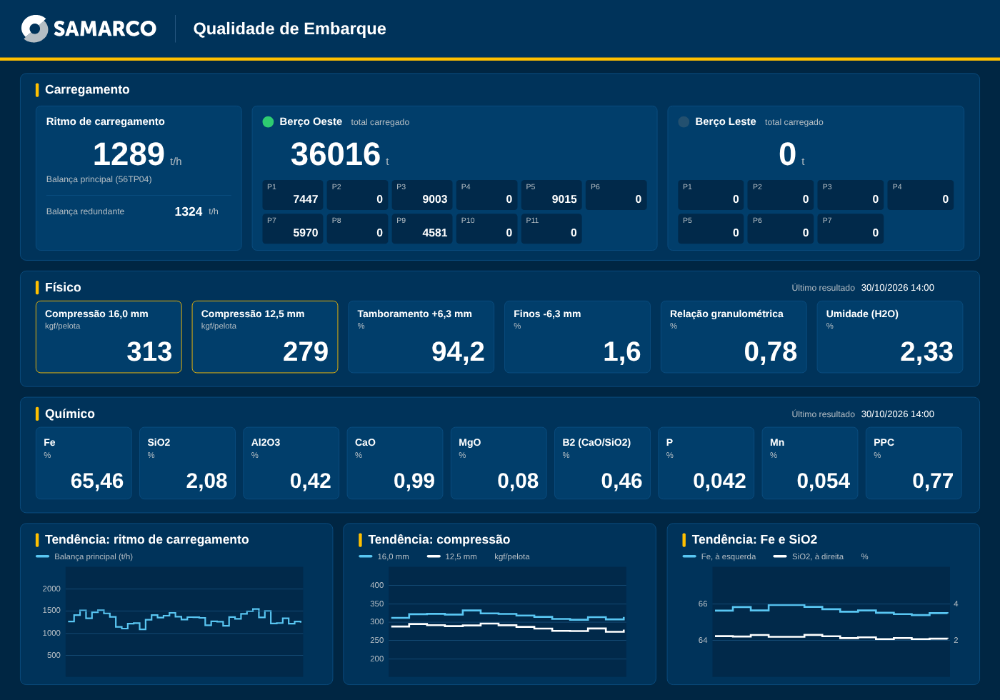
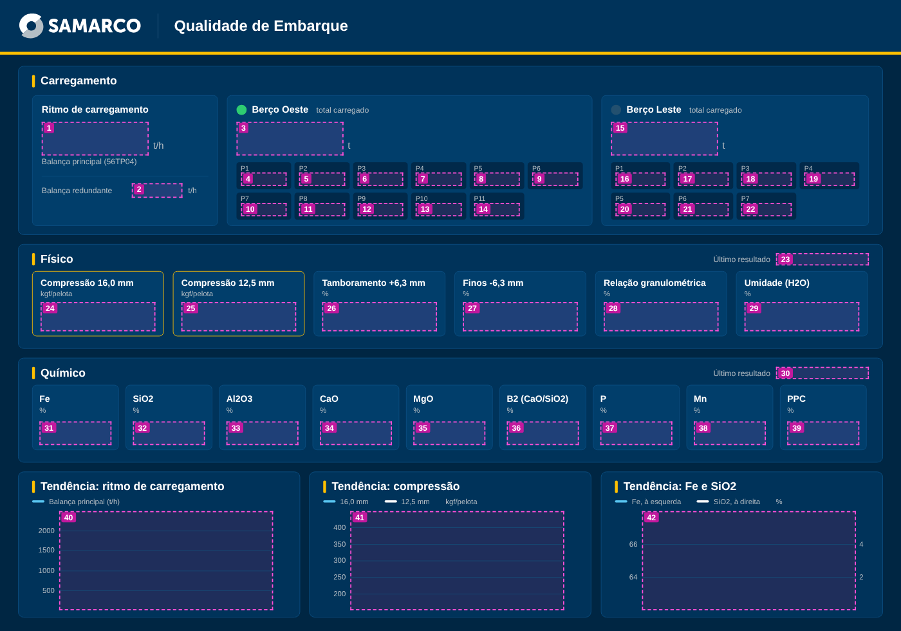

# Passo a passo: tela Qualidade de Embarque no Aspen (versão 1)

**Tela:** Qualidade de Embarque, padrão visual Samarco: ritmo de carregamento, total carregado por berço e por porão, resultados físicos e químicos do embarque e tendências

**Resultado esperado:** igual a `tela_exemplo_normal.png` (dados simulados)

**Tempo estimado:** 20 minutos

## O que vem pronto no arquivo

O arquivo `Qualidade_de_Embarque.atgraphic` foi gerado pelo mesmo processo da tela Compressão Online Usina 4, que já abriu no seu PIMS. Tudo é objeto nativo do Aspen e não perde nitidez ao maximizar. A tela não tem limites de especificação: mostra apenas os resultados.

| Conteúdo | Quantidade |
|---|---|
| Painéis, linhas e logotipo oficial em polígonos | 84 |
| Textos fixos | 88 |
| Campos de dados ligados às tags | 39 |
| Tendências com penas e escala definidas | 3 |
| Lâmpadas animadas (berço com carga) | 2 |

## Parte A. Abrir

**A1.** Copie `Qualidade_de_Embarque.atgraphic` para a pasta de rede das telas do laboratório.

**A2.** Abra no **Aspen Process Graphics Editor**, compare com `tela_exemplo_normal.png` e maximize.

**Se der erro ao abrir:** tente `teste_minimo.atgraphic` e me envie a captura da mensagem, dizendo se o arquivo de teste abriu.

## Parte B. Ajustes nos campos (no editor)

**B1. Atributo de data e hora.** Os campos "Último resultado" do Físico (objeto 23) e do Químico (objeto 30) vêm com o atributo `VAL` e mostram um número no lugar da hora. Dê duplo clique em cada um e troque `VAL` pelo atributo de data e hora da lista. Se preferir, apague os dois campos e o texto "Último resultado".

**B2. Mapa das tags de qualidade.** Os 15 resultados físicos e químicos usam o mapa `IP_MESVALOR`, o mesmo da tag de compressão do laboratório que já funciona na outra tela. Se algum campo mostrar `***`, abra o campo e confira o mapa na lista.

**B3. Carregamento.** Ritmo, totais e porões usam o mapa `IP_ANALOGMAP`, como na tela de embarque atual. Nada a fazer.

## Parte C. Tendências

| Objeto | Penas | Escala |
|---|---|---|
| 40 (ritmo de carregamento) | `008-WI-010` (balança principal, azul claro) | 0 a 2500 t/h |
| 41 (compressão) | `M0620010000-0031-TNLFU` (16,0 mm, azul claro) e `M0620010000-0035-TNLFU` (12,5 mm, branca) | 150 a 450 nas duas |
| 42 (Fe e SiO2) | `M0620010000-0002-TNLQU` (Fe, azul claro) e `M0620010000-0004-TNLQU` (SiO2, branca) | Fe 62 a 68; SiO2 0 a 6 |

**C1.** Na barra de tempo de cada tendência, use o período que preferir. Sugestão: **`24:00:00`** no ritmo e **`72:00:00`** na qualidade (os resultados do embarque são menos frequentes).

**C2.** Os números das escalas são parte fixa da tela. Se mudar a escala de uma pena, os números deixam de coincidir com a linha. Se os valores reais ficarem fora das escalas, me avise que eu ajusto.

## Parte D. Lâmpadas (já prontas)

| Lâmpada | Tag | Acende quando |
|---|---|---|
| Berço Oeste | `309-WIT-004.TOT_NAV_OE` | total carregado maior que zero, em verde |
| Berço Leste | `309-WIT-004.TOT_NAV_LE` | total carregado maior que zero, em verde |

A lâmpada indica o berço com carga registrada. Se o totalizador não for zerado ao fim de cada navio, as duas podem ficar acesas; nesse caso, me passe a tag que indica o berço em operação.

## Parte E. Salvar

**E1.** **Arquivo > Salvar**. Abra no Process Explorer e maximize para conferir.

## Parte F. Problemas comuns

| Problema | Solução |
|---|---|
| Erro ao abrir | Tente `teste_minimo.atgraphic` e envie a captura (Parte A) |
| Hora mostra um número | Parte B1 |
| Campo com `***` | Tag ou mapa não encontrado: confira na lista do campo (Parte B2) |
| Linha fora da escala da tendência | Me avise para ajustar a escala (Parte C2) |

## Anexo. Fichas dos objetos dinâmicos

Referência caso algum objeto precise ser refeito à mão. Posições em unidades da tela de 50 x 35.

### Objeto 1: Ritmo de carregamento: balança principal (t/h)

| Propriedade | Valor |
|---|---|
| Ferramenta | Campo de dados |
| Posição em unidades (X ; Y) | 2,31 ; 6,75 |
| Tamanho em unidades (largura ; altura) | 5,94 ; 1,88 |
| Tag | `008-WI-010` |
| Mapa | `IP_ANALOGMAP` |
| Atributo | `VAL` |
| Fonte | Arial negrito, já definida no arquivo |
| Alinhamento | Direita |
| Cor do texto | RGB 255, 255, 255 |
| Cor de fundo | RGB 1, 62, 107 (ou transparente), sem borda |
| Formato | Sem casas decimais (0) |
| Regra de cor | Nenhuma |

### Objeto 2: Ritmo de carregamento: balança redundante (t/h)

| Propriedade | Valor |
|---|---|
| Ferramenta | Campo de dados |
| Posição em unidades (X ; Y) | 7,31 ; 10,16 |
| Tamanho em unidades (largura ; altura) | 2,81 ; 0,81 |
| Tag | `008-WI-010_1` |
| Mapa | `IP_ANALOGMAP` |
| Atributo | `VAL` |
| Fonte | Arial negrito, já definida no arquivo |
| Alinhamento | Direita |
| Cor do texto | RGB 255, 255, 255 |
| Cor de fundo | RGB 1, 62, 107 (ou transparente), sem borda |
| Formato | Sem casas decimais (0) |
| Regra de cor | Nenhuma |

### Objeto 3: Berço Oeste: total carregado (t)

| Propriedade | Valor |
|---|---|
| Ferramenta | Campo de dados |
| Posição em unidades (X ; Y) | 13,11 ; 6,75 |
| Tamanho em unidades (largura ; altura) | 5,94 ; 1,88 |
| Tag | `309-WIT-004.TOT_NAV_OE` |
| Mapa | `IP_ANALOGMAP` |
| Atributo | `VAL` |
| Fonte | Arial negrito, já definida no arquivo |
| Alinhamento | Direita |
| Cor do texto | RGB 255, 255, 255 |
| Cor de fundo | RGB 1, 62, 107 (ou transparente), sem borda |
| Formato | Sem casas decimais (0) |
| Regra de cor | Nenhuma |
| Observação | A lâmpada ao lado do título acende em verde quando o total é maior que zero (já vem pronta). |

### Objeto 4: Berço Oeste: porão P1 (t)

| Propriedade | Valor |
|---|---|
| Ferramenta | Campo de dados |
| Posição em unidades (X ; Y) | 13,36 ; 9,56 |
| Tamanho em unidades (largura ; altura) | 2,55 ; 0,75 |
| Tag | `309-WIT-004.TOT_POR_OE1` |
| Mapa | `IP_ANALOGMAP` |
| Atributo | `VAL` |
| Fonte | Arial negrito, já definida no arquivo |
| Alinhamento | Direita |
| Cor do texto | RGB 255, 255, 255 |
| Cor de fundo | RGB 1, 41, 74 (ou transparente), sem borda |
| Formato | Sem casas decimais (0) |
| Regra de cor | Nenhuma |

### Objeto 5: Berço Oeste: porão P2 (t)

| Propriedade | Valor |
|---|---|
| Ferramenta | Campo de dados |
| Posição em unidades (X ; Y) | 16,60 ; 9,56 |
| Tamanho em unidades (largura ; altura) | 2,55 ; 0,75 |
| Tag | `309-WIT-004.TOT_POR_OE2` |
| Mapa | `IP_ANALOGMAP` |
| Atributo | `VAL` |
| Fonte | Arial negrito, já definida no arquivo |
| Alinhamento | Direita |
| Cor do texto | RGB 255, 255, 255 |
| Cor de fundo | RGB 1, 41, 74 (ou transparente), sem borda |
| Formato | Sem casas decimais (0) |
| Regra de cor | Nenhuma |

### Objeto 6: Berço Oeste: porão P3 (t)

| Propriedade | Valor |
|---|---|
| Ferramenta | Campo de dados |
| Posição em unidades (X ; Y) | 19,83 ; 9,56 |
| Tamanho em unidades (largura ; altura) | 2,55 ; 0,75 |
| Tag | `309-WIT-004.TOT_POR_OE3` |
| Mapa | `IP_ANALOGMAP` |
| Atributo | `VAL` |
| Fonte | Arial negrito, já definida no arquivo |
| Alinhamento | Direita |
| Cor do texto | RGB 255, 255, 255 |
| Cor de fundo | RGB 1, 41, 74 (ou transparente), sem borda |
| Formato | Sem casas decimais (0) |
| Regra de cor | Nenhuma |

### Objeto 7: Berço Oeste: porão P4 (t)

| Propriedade | Valor |
|---|---|
| Ferramenta | Campo de dados |
| Posição em unidades (X ; Y) | 23,07 ; 9,56 |
| Tamanho em unidades (largura ; altura) | 2,55 ; 0,75 |
| Tag | `309-WIT-004.TOT_POR_OE4` |
| Mapa | `IP_ANALOGMAP` |
| Atributo | `VAL` |
| Fonte | Arial negrito, já definida no arquivo |
| Alinhamento | Direita |
| Cor do texto | RGB 255, 255, 255 |
| Cor de fundo | RGB 1, 41, 74 (ou transparente), sem borda |
| Formato | Sem casas decimais (0) |
| Regra de cor | Nenhuma |

### Objeto 8: Berço Oeste: porão P5 (t)

| Propriedade | Valor |
|---|---|
| Ferramenta | Campo de dados |
| Posição em unidades (X ; Y) | 26,30 ; 9,56 |
| Tamanho em unidades (largura ; altura) | 2,55 ; 0,75 |
| Tag | `309-WIT-004.TOT_POR_OE5` |
| Mapa | `IP_ANALOGMAP` |
| Atributo | `VAL` |
| Fonte | Arial negrito, já definida no arquivo |
| Alinhamento | Direita |
| Cor do texto | RGB 255, 255, 255 |
| Cor de fundo | RGB 1, 41, 74 (ou transparente), sem borda |
| Formato | Sem casas decimais (0) |
| Regra de cor | Nenhuma |

### Objeto 9: Berço Oeste: porão P6 (t)

| Propriedade | Valor |
|---|---|
| Ferramenta | Campo de dados |
| Posição em unidades (X ; Y) | 29,54 ; 9,56 |
| Tamanho em unidades (largura ; altura) | 2,55 ; 0,75 |
| Tag | `309-WIT-004.TOT_POR_OE6` |
| Mapa | `IP_ANALOGMAP` |
| Atributo | `VAL` |
| Fonte | Arial negrito, já definida no arquivo |
| Alinhamento | Direita |
| Cor do texto | RGB 255, 255, 255 |
| Cor de fundo | RGB 1, 41, 74 (ou transparente), sem borda |
| Formato | Sem casas decimais (0) |
| Regra de cor | Nenhuma |

### Objeto 10: Berço Oeste: porão P7 (t)

| Propriedade | Valor |
|---|---|
| Ferramenta | Campo de dados |
| Posição em unidades (X ; Y) | 13,36 ; 11,25 |
| Tamanho em unidades (largura ; altura) | 2,55 ; 0,75 |
| Tag | `309-WIT-004.TOT_POR_OE7` |
| Mapa | `IP_ANALOGMAP` |
| Atributo | `VAL` |
| Fonte | Arial negrito, já definida no arquivo |
| Alinhamento | Direita |
| Cor do texto | RGB 255, 255, 255 |
| Cor de fundo | RGB 1, 41, 74 (ou transparente), sem borda |
| Formato | Sem casas decimais (0) |
| Regra de cor | Nenhuma |

### Objeto 11: Berço Oeste: porão P8 (t)

| Propriedade | Valor |
|---|---|
| Ferramenta | Campo de dados |
| Posição em unidades (X ; Y) | 16,60 ; 11,25 |
| Tamanho em unidades (largura ; altura) | 2,55 ; 0,75 |
| Tag | `309-WIT-004.TOT_POR_OE8` |
| Mapa | `IP_ANALOGMAP` |
| Atributo | `VAL` |
| Fonte | Arial negrito, já definida no arquivo |
| Alinhamento | Direita |
| Cor do texto | RGB 255, 255, 255 |
| Cor de fundo | RGB 1, 41, 74 (ou transparente), sem borda |
| Formato | Sem casas decimais (0) |
| Regra de cor | Nenhuma |

### Objeto 12: Berço Oeste: porão P9 (t)

| Propriedade | Valor |
|---|---|
| Ferramenta | Campo de dados |
| Posição em unidades (X ; Y) | 19,83 ; 11,25 |
| Tamanho em unidades (largura ; altura) | 2,55 ; 0,75 |
| Tag | `309-WIT-004.TOT_POR_OE9` |
| Mapa | `IP_ANALOGMAP` |
| Atributo | `VAL` |
| Fonte | Arial negrito, já definida no arquivo |
| Alinhamento | Direita |
| Cor do texto | RGB 255, 255, 255 |
| Cor de fundo | RGB 1, 41, 74 (ou transparente), sem borda |
| Formato | Sem casas decimais (0) |
| Regra de cor | Nenhuma |

### Objeto 13: Berço Oeste: porão P10 (t)

| Propriedade | Valor |
|---|---|
| Ferramenta | Campo de dados |
| Posição em unidades (X ; Y) | 23,07 ; 11,25 |
| Tamanho em unidades (largura ; altura) | 2,55 ; 0,75 |
| Tag | `309-WIT-004.TOT_POR_OE10` |
| Mapa | `IP_ANALOGMAP` |
| Atributo | `VAL` |
| Fonte | Arial negrito, já definida no arquivo |
| Alinhamento | Direita |
| Cor do texto | RGB 255, 255, 255 |
| Cor de fundo | RGB 1, 41, 74 (ou transparente), sem borda |
| Formato | Sem casas decimais (0) |
| Regra de cor | Nenhuma |

### Objeto 14: Berço Oeste: porão P11 (t)

| Propriedade | Valor |
|---|---|
| Ferramenta | Campo de dados |
| Posição em unidades (X ; Y) | 26,30 ; 11,25 |
| Tamanho em unidades (largura ; altura) | 2,55 ; 0,75 |
| Tag | `309-WIT-004.TOT_POR_OE11` |
| Mapa | `IP_ANALOGMAP` |
| Atributo | `VAL` |
| Fonte | Arial negrito, já definida no arquivo |
| Alinhamento | Direita |
| Cor do texto | RGB 255, 255, 255 |
| Cor de fundo | RGB 1, 41, 74 (ou transparente), sem borda |
| Formato | Sem casas decimais (0) |
| Regra de cor | Nenhuma |

### Objeto 15: Berço Leste: total carregado (t)

| Propriedade | Valor |
|---|---|
| Ferramenta | Campo de dados |
| Posição em unidades (X ; Y) | 33,90 ; 6,75 |
| Tamanho em unidades (largura ; altura) | 5,94 ; 1,88 |
| Tag | `309-WIT-004.TOT_NAV_LE` |
| Mapa | `IP_ANALOGMAP` |
| Atributo | `VAL` |
| Fonte | Arial negrito, já definida no arquivo |
| Alinhamento | Direita |
| Cor do texto | RGB 255, 255, 255 |
| Cor de fundo | RGB 1, 62, 107 (ou transparente), sem borda |
| Formato | Sem casas decimais (0) |
| Regra de cor | Nenhuma |
| Observação | A lâmpada ao lado do título acende em verde quando o total é maior que zero (já vem pronta). |

### Objeto 16: Berço Leste: porão P1 (t)

| Propriedade | Valor |
|---|---|
| Ferramenta | Campo de dados |
| Posição em unidades (X ; Y) | 34,15 ; 9,56 |
| Tamanho em unidades (largura ; altura) | 2,81 ; 0,75 |
| Tag | `309-WIT-004.TOT_POR_LE01` |
| Mapa | `IP_ANALOGMAP` |
| Atributo | `VAL` |
| Fonte | Arial negrito, já definida no arquivo |
| Alinhamento | Direita |
| Cor do texto | RGB 255, 255, 255 |
| Cor de fundo | RGB 1, 41, 74 (ou transparente), sem borda |
| Formato | Sem casas decimais (0) |
| Regra de cor | Nenhuma |

### Objeto 17: Berço Leste: porão P2 (t)

| Propriedade | Valor |
|---|---|
| Ferramenta | Campo de dados |
| Posição em unidades (X ; Y) | 37,64 ; 9,56 |
| Tamanho em unidades (largura ; altura) | 2,81 ; 0,75 |
| Tag | `309-WIT-004.TOT_POR_LE02` |
| Mapa | `IP_ANALOGMAP` |
| Atributo | `VAL` |
| Fonte | Arial negrito, já definida no arquivo |
| Alinhamento | Direita |
| Cor do texto | RGB 255, 255, 255 |
| Cor de fundo | RGB 1, 41, 74 (ou transparente), sem borda |
| Formato | Sem casas decimais (0) |
| Regra de cor | Nenhuma |

### Objeto 18: Berço Leste: porão P3 (t)

| Propriedade | Valor |
|---|---|
| Ferramenta | Campo de dados |
| Posição em unidades (X ; Y) | 41,14 ; 9,56 |
| Tamanho em unidades (largura ; altura) | 2,81 ; 0,75 |
| Tag | `309-WIT-004.TOT_POR_LE03` |
| Mapa | `IP_ANALOGMAP` |
| Atributo | `VAL` |
| Fonte | Arial negrito, já definida no arquivo |
| Alinhamento | Direita |
| Cor do texto | RGB 255, 255, 255 |
| Cor de fundo | RGB 1, 41, 74 (ou transparente), sem borda |
| Formato | Sem casas decimais (0) |
| Regra de cor | Nenhuma |

### Objeto 19: Berço Leste: porão P4 (t)

| Propriedade | Valor |
|---|---|
| Ferramenta | Campo de dados |
| Posição em unidades (X ; Y) | 44,63 ; 9,56 |
| Tamanho em unidades (largura ; altura) | 2,81 ; 0,75 |
| Tag | `309-WIT-004.TOT_POR_LE04` |
| Mapa | `IP_ANALOGMAP` |
| Atributo | `VAL` |
| Fonte | Arial negrito, já definida no arquivo |
| Alinhamento | Direita |
| Cor do texto | RGB 255, 255, 255 |
| Cor de fundo | RGB 1, 41, 74 (ou transparente), sem borda |
| Formato | Sem casas decimais (0) |
| Regra de cor | Nenhuma |

### Objeto 20: Berço Leste: porão P5 (t)

| Propriedade | Valor |
|---|---|
| Ferramenta | Campo de dados |
| Posição em unidades (X ; Y) | 34,15 ; 11,25 |
| Tamanho em unidades (largura ; altura) | 2,81 ; 0,75 |
| Tag | `309-WIT-004.TOT_POR_LE05` |
| Mapa | `IP_ANALOGMAP` |
| Atributo | `VAL` |
| Fonte | Arial negrito, já definida no arquivo |
| Alinhamento | Direita |
| Cor do texto | RGB 255, 255, 255 |
| Cor de fundo | RGB 1, 41, 74 (ou transparente), sem borda |
| Formato | Sem casas decimais (0) |
| Regra de cor | Nenhuma |

### Objeto 21: Berço Leste: porão P6 (t)

| Propriedade | Valor |
|---|---|
| Ferramenta | Campo de dados |
| Posição em unidades (X ; Y) | 37,64 ; 11,25 |
| Tamanho em unidades (largura ; altura) | 2,81 ; 0,75 |
| Tag | `309-WIT-004.TOT_POR_LE06` |
| Mapa | `IP_ANALOGMAP` |
| Atributo | `VAL` |
| Fonte | Arial negrito, já definida no arquivo |
| Alinhamento | Direita |
| Cor do texto | RGB 255, 255, 255 |
| Cor de fundo | RGB 1, 41, 74 (ou transparente), sem borda |
| Formato | Sem casas decimais (0) |
| Regra de cor | Nenhuma |

### Objeto 22: Berço Leste: porão P7 (t)

| Propriedade | Valor |
|---|---|
| Ferramenta | Campo de dados |
| Posição em unidades (X ; Y) | 41,14 ; 11,25 |
| Tamanho em unidades (largura ; altura) | 2,81 ; 0,75 |
| Tag | `309-WIT-004.TOT_POR_LE07` |
| Mapa | `IP_ANALOGMAP` |
| Atributo | `VAL` |
| Fonte | Arial negrito, já definida no arquivo |
| Alinhamento | Direita |
| Cor do texto | RGB 255, 255, 255 |
| Cor de fundo | RGB 1, 41, 74 (ou transparente), sem borda |
| Formato | Sem casas decimais (0) |
| Regra de cor | Nenhuma |

### Objeto 23: Físico: último resultado

| Propriedade | Valor |
|---|---|
| Ferramenta | Campo de dados |
| Posição em unidades (X ; Y) | 43,06 ; 14,02 |
| Tamanho em unidades (largura ; altura) | 5,16 ; 0,69 |
| Tag | `M0620010000-0031-TNLFU` |
| Mapa | `IP_MESVALOR` |
| Atributo | `VAL` no arquivo: **trocar pelo atributo de data e hora** (Parte B) |
| Fonte | Arial, já definida no arquivo |
| Alinhamento | Esquerda |
| Cor do texto | RGB 255, 255, 255 |
| Cor de fundo | RGB 0, 51, 90 (ou transparente), sem borda |
| Formato | dd/mm/aaaa hh:mm:ss |
| Regra de cor | Nenhuma |

### Objeto 24: Físico: Compressão 16,0 mm (kgf/pelota)

| Propriedade | Valor |
|---|---|
| Ferramenta | Campo de dados |
| Posição em unidades (X ; Y) | 2,25 ; 16,75 |
| Tamanho em unidades (largura ; altura) | 6,38 ; 1,63 |
| Tag | `M0620010000-0031-TNLFU` |
| Mapa | `IP_MESVALOR` |
| Atributo | `VAL` |
| Fonte | Arial negrito, já definida no arquivo |
| Alinhamento | Direita |
| Cor do texto | RGB 255, 255, 255 |
| Cor de fundo | RGB 1, 62, 107 (ou transparente), sem borda |
| Formato | Sem casas decimais (0) |
| Regra de cor | Nenhuma |

### Objeto 25: Físico: Compressão 12,5 mm (kgf/pelota)

| Propriedade | Valor |
|---|---|
| Ferramenta | Campo de dados |
| Posição em unidades (X ; Y) | 10,06 ; 16,75 |
| Tamanho em unidades (largura ; altura) | 6,38 ; 1,63 |
| Tag | `M0620010000-0035-TNLFU` |
| Mapa | `IP_MESVALOR` |
| Atributo | `VAL` |
| Fonte | Arial negrito, já definida no arquivo |
| Alinhamento | Direita |
| Cor do texto | RGB 255, 255, 255 |
| Cor de fundo | RGB 1, 62, 107 (ou transparente), sem borda |
| Formato | Sem casas decimais (0) |
| Regra de cor | Nenhuma |

### Objeto 26: Físico: Tamboramento +6,3 mm (%)

| Propriedade | Valor |
|---|---|
| Ferramenta | Campo de dados |
| Posição em unidades (X ; Y) | 17,88 ; 16,75 |
| Tamanho em unidades (largura ; altura) | 6,38 ; 1,63 |
| Tag | `M0620010000-0029-TNLFU` |
| Mapa | `IP_MESVALOR` |
| Atributo | `VAL` |
| Fonte | Arial negrito, já definida no arquivo |
| Alinhamento | Direita |
| Cor do texto | RGB 255, 255, 255 |
| Cor de fundo | RGB 1, 62, 107 (ou transparente), sem borda |
| Formato | 1 casa decimal (0,0) |
| Regra de cor | Nenhuma |

### Objeto 27: Físico: Finos -6,3 mm (%)

| Propriedade | Valor |
|---|---|
| Ferramenta | Campo de dados |
| Posição em unidades (X ; Y) | 25,69 ; 16,75 |
| Tamanho em unidades (largura ; altura) | 6,38 ; 1,63 |
| Tag | `M0620010000-0026-TNLFU` |
| Mapa | `IP_MESVALOR` |
| Atributo | `VAL` |
| Fonte | Arial negrito, já definida no arquivo |
| Alinhamento | Direita |
| Cor do texto | RGB 255, 255, 255 |
| Cor de fundo | RGB 1, 62, 107 (ou transparente), sem borda |
| Formato | 1 casa decimal (0,0) |
| Regra de cor | Nenhuma |

### Objeto 28: Físico: Relação granulométrica (%)

| Propriedade | Valor |
|---|---|
| Ferramenta | Campo de dados |
| Posição em unidades (X ; Y) | 33,50 ; 16,75 |
| Tamanho em unidades (largura ; altura) | 6,38 ; 1,63 |
| Tag | `M0620010000-2021-TNLFU` |
| Mapa | `IP_MESVALOR` |
| Atributo | `VAL` |
| Fonte | Arial negrito, já definida no arquivo |
| Alinhamento | Direita |
| Cor do texto | RGB 255, 255, 255 |
| Cor de fundo | RGB 1, 62, 107 (ou transparente), sem borda |
| Formato | 2 casas decimais (0,00) |
| Regra de cor | Nenhuma |

### Objeto 29: Físico: Umidade H2O (%)

| Propriedade | Valor |
|---|---|
| Ferramenta | Campo de dados |
| Posição em unidades (X ; Y) | 41,31 ; 16,75 |
| Tamanho em unidades (largura ; altura) | 6,38 ; 1,63 |
| Tag | `M0620010000-0001-TNLFU` |
| Mapa | `IP_MESVALOR` |
| Atributo | `VAL` |
| Fonte | Arial negrito, já definida no arquivo |
| Alinhamento | Direita |
| Cor do texto | RGB 255, 255, 255 |
| Cor de fundo | RGB 1, 62, 107 (ou transparente), sem borda |
| Formato | 2 casas decimais (0,00) |
| Regra de cor | Nenhuma |

### Objeto 30: Químico: último resultado

| Propriedade | Valor |
|---|---|
| Ferramenta | Campo de dados |
| Posição em unidades (X ; Y) | 43,06 ; 20,33 |
| Tamanho em unidades (largura ; altura) | 5,16 ; 0,69 |
| Tag | `M0620010000-0002-TNLQU` |
| Mapa | `IP_MESVALOR` |
| Atributo | `VAL` no arquivo: **trocar pelo atributo de data e hora** (Parte B) |
| Fonte | Arial, já definida no arquivo |
| Alinhamento | Esquerda |
| Cor do texto | RGB 255, 255, 255 |
| Cor de fundo | RGB 0, 51, 90 (ou transparente), sem borda |
| Formato | dd/mm/aaaa hh:mm:ss |
| Regra de cor | Nenhuma |

### Objeto 31: Químico: Fe (%)

| Propriedade | Valor |
|---|---|
| Ferramenta | Campo de dados |
| Posição em unidades (X ; Y) | 2,19 ; 23,38 |
| Tamanho em unidades (largura ; altura) | 4,00 ; 1,31 |
| Tag | `M0620010000-0002-TNLQU` |
| Mapa | `IP_MESVALOR` |
| Atributo | `VAL` |
| Fonte | Arial negrito, já definida no arquivo |
| Alinhamento | Direita |
| Cor do texto | RGB 255, 255, 255 |
| Cor de fundo | RGB 1, 62, 107 (ou transparente), sem borda |
| Formato | 2 casas decimais (0,00) |
| Regra de cor | Nenhuma |

### Objeto 32: Químico: SiO2 (%)

| Propriedade | Valor |
|---|---|
| Ferramenta | Campo de dados |
| Posição em unidades (X ; Y) | 7,38 ; 23,38 |
| Tamanho em unidades (largura ; altura) | 4,00 ; 1,31 |
| Tag | `M0620010000-0004-TNLQU` |
| Mapa | `IP_MESVALOR` |
| Atributo | `VAL` |
| Fonte | Arial negrito, já definida no arquivo |
| Alinhamento | Direita |
| Cor do texto | RGB 255, 255, 255 |
| Cor de fundo | RGB 1, 62, 107 (ou transparente), sem borda |
| Formato | 2 casas decimais (0,00) |
| Regra de cor | Nenhuma |

### Objeto 33: Químico: Al2O3 (%)

| Propriedade | Valor |
|---|---|
| Ferramenta | Campo de dados |
| Posição em unidades (X ; Y) | 12,56 ; 23,38 |
| Tamanho em unidades (largura ; altura) | 4,00 ; 1,31 |
| Tag | `M0620010000-0005-TNLQU` |
| Mapa | `IP_MESVALOR` |
| Atributo | `VAL` |
| Fonte | Arial negrito, já definida no arquivo |
| Alinhamento | Direita |
| Cor do texto | RGB 255, 255, 255 |
| Cor de fundo | RGB 1, 62, 107 (ou transparente), sem borda |
| Formato | 2 casas decimais (0,00) |
| Regra de cor | Nenhuma |

### Objeto 34: Químico: CaO (%)

| Propriedade | Valor |
|---|---|
| Ferramenta | Campo de dados |
| Posição em unidades (X ; Y) | 17,75 ; 23,38 |
| Tamanho em unidades (largura ; altura) | 4,00 ; 1,31 |
| Tag | `M0620010000-0006-TNLQU` |
| Mapa | `IP_MESVALOR` |
| Atributo | `VAL` |
| Fonte | Arial negrito, já definida no arquivo |
| Alinhamento | Direita |
| Cor do texto | RGB 255, 255, 255 |
| Cor de fundo | RGB 1, 62, 107 (ou transparente), sem borda |
| Formato | 2 casas decimais (0,00) |
| Regra de cor | Nenhuma |

### Objeto 35: Químico: MgO (%)

| Propriedade | Valor |
|---|---|
| Ferramenta | Campo de dados |
| Posição em unidades (X ; Y) | 22,94 ; 23,38 |
| Tamanho em unidades (largura ; altura) | 4,00 ; 1,31 |
| Tag | `M0620010000-0007-TNLQU` |
| Mapa | `IP_MESVALOR` |
| Atributo | `VAL` |
| Fonte | Arial negrito, já definida no arquivo |
| Alinhamento | Direita |
| Cor do texto | RGB 255, 255, 255 |
| Cor de fundo | RGB 1, 62, 107 (ou transparente), sem borda |
| Formato | 2 casas decimais (0,00) |
| Regra de cor | Nenhuma |

### Objeto 36: Químico: B2 (%)

| Propriedade | Valor |
|---|---|
| Ferramenta | Campo de dados |
| Posição em unidades (X ; Y) | 28,13 ; 23,38 |
| Tamanho em unidades (largura ; altura) | 4,00 ; 1,31 |
| Tag | `M0620010000-0018-TNLQU` |
| Mapa | `IP_MESVALOR` |
| Atributo | `VAL` |
| Fonte | Arial negrito, já definida no arquivo |
| Alinhamento | Direita |
| Cor do texto | RGB 255, 255, 255 |
| Cor de fundo | RGB 1, 62, 107 (ou transparente), sem borda |
| Formato | 2 casas decimais (0,00) |
| Regra de cor | Nenhuma |

### Objeto 37: Químico: P (%)

| Propriedade | Valor |
|---|---|
| Ferramenta | Campo de dados |
| Posição em unidades (X ; Y) | 33,31 ; 23,38 |
| Tamanho em unidades (largura ; altura) | 4,00 ; 1,31 |
| Tag | `M0620010000-0008-TNLQU` |
| Mapa | `IP_MESVALOR` |
| Atributo | `VAL` |
| Fonte | Arial negrito, já definida no arquivo |
| Alinhamento | Direita |
| Cor do texto | RGB 255, 255, 255 |
| Cor de fundo | RGB 1, 62, 107 (ou transparente), sem borda |
| Formato | 3 casas decimais (0,000) |
| Regra de cor | Nenhuma |

### Objeto 38: Químico: Mn (%)

| Propriedade | Valor |
|---|---|
| Ferramenta | Campo de dados |
| Posição em unidades (X ; Y) | 38,50 ; 23,38 |
| Tamanho em unidades (largura ; altura) | 4,00 ; 1,31 |
| Tag | `M0620010000-0115-TNLQU` |
| Mapa | `IP_MESVALOR` |
| Atributo | `VAL` |
| Fonte | Arial negrito, já definida no arquivo |
| Alinhamento | Direita |
| Cor do texto | RGB 255, 255, 255 |
| Cor de fundo | RGB 1, 62, 107 (ou transparente), sem borda |
| Formato | 3 casas decimais (0,000) |
| Regra de cor | Nenhuma |

### Objeto 39: Químico: PPC (%)

| Propriedade | Valor |
|---|---|
| Ferramenta | Campo de dados |
| Posição em unidades (X ; Y) | 43,69 ; 23,38 |
| Tamanho em unidades (largura ; altura) | 4,00 ; 1,31 |
| Tag | `M0620010000-0013-TNLQU` |
| Mapa | `IP_MESVALOR` |
| Atributo | `VAL` |
| Fonte | Arial negrito, já definida no arquivo |
| Alinhamento | Direita |
| Cor do texto | RGB 255, 255, 255 |
| Cor de fundo | RGB 1, 62, 107 (ou transparente), sem borda |
| Formato | 2 casas decimais (0,00) |
| Regra de cor | Nenhuma |

### Objeto 40: Tendência: ritmo de carregamento

| Propriedade | Valor |
|---|---|
| Ferramenta | Tendência (plot) |
| Posição em unidades (X ; Y) | 3,28 ; 28,34 |
| Tamanho em unidades (largura ; altura) | 11,88 ; 5,50 |
| Observação | Já vem pronta no arquivo, escala 0 a 2500 t/h. Ver Parte C. |

### Objeto 41: Tendência: compressão

| Propriedade | Valor |
|---|---|
| Ferramenta | Tendência (plot) |
| Posição em unidades (X ; Y) | 19,44 ; 28,34 |
| Tamanho em unidades (largura ; altura) | 11,88 ; 5,50 |
| Observação | Já vem pronta no arquivo, escala 150 a 450 kgf/pelota. Ver Parte C. |

### Objeto 42: Tendência: Fe e SiO2

| Propriedade | Valor |
|---|---|
| Ferramenta | Tendência (plot) |
| Posição em unidades (X ; Y) | 35,63 ; 28,34 |
| Tamanho em unidades (largura ; altura) | 11,88 ; 5,50 |
| Observação | Já vem pronta no arquivo, Fe de 62 a 68% e SiO2 de 0 a 6%. Ver Parte C. |

