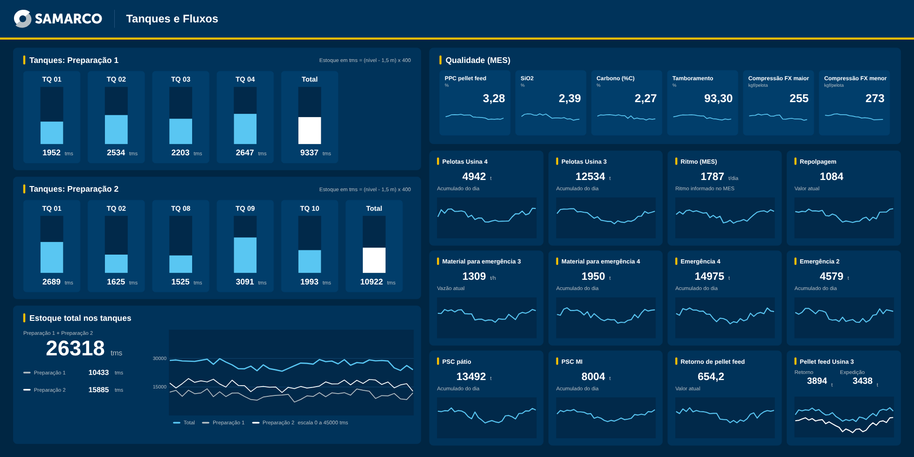
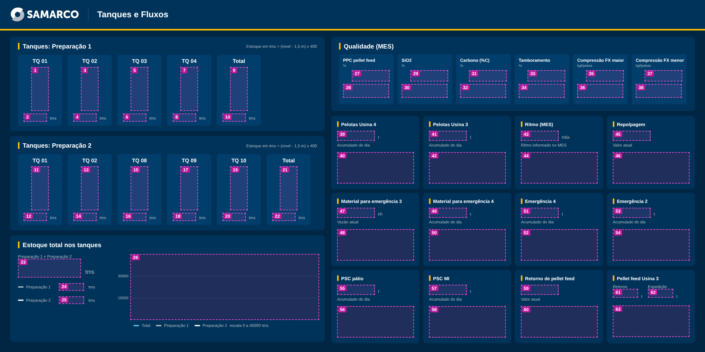

# Passo a passo: tela Tanques e Fluxos no Aspen (versão 1)

**Tela:** Tanques e Fluxos, padrão visual Samarco. Refaz a tela Tanques com as mesmas tags, fórmulas e escalas: estoque dos 9 tanques e totais, qualidade do MES e 12 fluxos com tendência.

**Resultado esperado:** igual a `tela_exemplo_normal.png` (dados simulados)

**Tempo estimado:** 15 minutos

## O que vem pronto no arquivo

O arquivo `Tanques_e_Fluxos.atgraphic` foi gerado pelo mesmo processo das telas Compressão Online Usina 4 e Qualidade de Embarque. Tudo é objeto nativo do Aspen e não perde nitidez ao maximizar. A tela tem 70 x 35 unidades, como a original.

| Conteúdo | Quantidade |
|---|---|
| Barras de nível dos tanques (com a fórmula da tela original) | 11 |
| Campos de dados ligados às tags ou às fórmulas | 33 |
| Tendências com penas e escala definidas | 19 |
| Textos fixos | 89 |

## Parte A. Abrir

**A1.** Copie `Tanques_e_Fluxos.atgraphic` para a pasta de rede das telas. A tela antiga pode ficar até esta ser conferida.

**A2.** Abra no **Aspen Process Graphics Editor**, compare com `tela_exemplo_normal.png` e maximize.

**Se der erro ao abrir:** tente `teste_minimo.atgraphic` (uma barra, um campo e uma tendência) e me envie a captura da mensagem.

## Parte B. Conferência rápida

**B1. Estoque dos tanques.** Cada tanque usa a fórmula da tela original: estoque em tms = (nível - 1,5 m) x 400, zero abaixo de 1,5 m. Compare os valores com a tela antiga aberta ao lado: devem ser iguais.

| Grupo | Tanques e tags de nível | Escala das barras |
|---|---|---|
| Preparação 1 | TQ 01 `lt-803`, TQ 02 `lt-805`, TQ 03 `lt-807`, TQ 04 `li-3802` | 0 a 5000 por tanque; total 0 a 20000 |
| Preparação 2 | TQ 01 `301HG001-LIT001-R`, TQ 02 `301HG002-LIT002-R`, TQ 08 `401-LI-001`, TQ 09 `401-LI-002`, TQ 10 `401-LI-004` | 0 a 5000 por tanque; total 0 a 25000 |

**B2. Nomes dos grupos.** Os nomes Preparação 1 e Preparação 2 seguem o texto "PREP 1 + PREP 2" da tela original. Se a fileira estiver trocada, me avise que eu inverto.

**B3. Qualidade e fluxos.** As tags, os mapas e as escalas são os da tela original. Nada a fazer, a menos que algum campo mostre `***`.

## Parte C. Tendências

**C1.** Na barra de tempo de cada tendência, use o período que preferir (a tela original não define). Sugestão: **`24:00:00`**.

**C2.** Não altere a escala das penas: as escalas escritas na tela (por exemplo, "Vazão, 0 a 2000 t/h") são texto fixo.

## Parte D. Salvar

**D1.** **Arquivo > Salvar**. Abra no Process Explorer e maximize para conferir.

## Parte E. Problemas comuns

| Problema | Solução |
|---|---|
| Erro ao abrir | Tente `teste_minimo.atgraphic` e envie a captura (Parte A) |
| Campo com `***` | Tag sem valor no PIMS: confira a mesma tag na tela antiga |
| Estoque diferente da tela antiga | Me envie as duas telas lado a lado |

## Anexo. Fichas dos objetos dinâmicos

Posições em unidades da tela de 70 x 35.

### Objeto 1: Tanques: Preparação 1: TQ 01, nível em tms

| Propriedade | Valor |
|---|---|
| Ferramenta | Barra (bargraph) |
| Posição em unidades (X ; Y) | 3,09 ; 6,66 |
| Tamanho em unidades (largura ; altura) | 1,75 ; 4,38 |
| Tag | Fórmula da tela original (ver Parte B) |
| Escala | 0 a 5000 tms |

### Objeto 2: Tanques: Preparação 1: TQ 01, estoque (tms)

| Propriedade | Valor |
|---|---|
| Ferramenta | Campo de dados |
| Posição em unidades (X ; Y) | 2,33 ; 11,28 |
| Tamanho em unidades (largura ; altura) | 2,31 ; 0,81 |
| Tag | Fórmula da tela original (ver Parte B) |
| Mapa | `Fixed` |
| Atributo | `VAL` |
| Fonte | Arial negrito, já definida no arquivo |
| Alinhamento | Direita |
| Cor do texto | RGB 255, 255, 255 |
| Cor de fundo | RGB 1, 62, 107 (ou transparente), sem borda |
| Formato | Sem casas decimais (0) |
| Regra de cor | Nenhuma |
| Observação | Campo calculado (fórmula da tela original). |

### Objeto 3: Tanques: Preparação 1: TQ 02, nível em tms

| Propriedade | Valor |
|---|---|
| Ferramenta | Barra (bargraph) |
| Posição em unidades (X ; Y) | 8,03 ; 6,66 |
| Tamanho em unidades (largura ; altura) | 1,75 ; 4,38 |
| Tag | Fórmula da tela original (ver Parte B) |
| Escala | 0 a 5000 tms |

### Objeto 4: Tanques: Preparação 1: TQ 02, estoque (tms)

| Propriedade | Valor |
|---|---|
| Ferramenta | Campo de dados |
| Posição em unidades (X ; Y) | 7,27 ; 11,28 |
| Tamanho em unidades (largura ; altura) | 2,31 ; 0,81 |
| Tag | Fórmula da tela original (ver Parte B) |
| Mapa | `Fixed` |
| Atributo | `VAL` |
| Fonte | Arial negrito, já definida no arquivo |
| Alinhamento | Direita |
| Cor do texto | RGB 255, 255, 255 |
| Cor de fundo | RGB 1, 62, 107 (ou transparente), sem borda |
| Formato | Sem casas decimais (0) |
| Regra de cor | Nenhuma |
| Observação | Campo calculado (fórmula da tela original). |

### Objeto 5: Tanques: Preparação 1: TQ 03, nível em tms

| Propriedade | Valor |
|---|---|
| Ferramenta | Barra (bargraph) |
| Posição em unidades (X ; Y) | 12,97 ; 6,66 |
| Tamanho em unidades (largura ; altura) | 1,75 ; 4,38 |
| Tag | Fórmula da tela original (ver Parte B) |
| Escala | 0 a 5000 tms |

### Objeto 6: Tanques: Preparação 1: TQ 03, estoque (tms)

| Propriedade | Valor |
|---|---|
| Ferramenta | Campo de dados |
| Posição em unidades (X ; Y) | 12,20 ; 11,28 |
| Tamanho em unidades (largura ; altura) | 2,31 ; 0,81 |
| Tag | Fórmula da tela original (ver Parte B) |
| Mapa | `Fixed` |
| Atributo | `VAL` |
| Fonte | Arial negrito, já definida no arquivo |
| Alinhamento | Direita |
| Cor do texto | RGB 255, 255, 255 |
| Cor de fundo | RGB 1, 62, 107 (ou transparente), sem borda |
| Formato | Sem casas decimais (0) |
| Regra de cor | Nenhuma |
| Observação | Campo calculado (fórmula da tela original). |

### Objeto 7: Tanques: Preparação 1: TQ 04, nível em tms

| Propriedade | Valor |
|---|---|
| Ferramenta | Barra (bargraph) |
| Posição em unidades (X ; Y) | 17,91 ; 6,66 |
| Tamanho em unidades (largura ; altura) | 1,75 ; 4,38 |
| Tag | Fórmula da tela original (ver Parte B) |
| Escala | 0 a 5000 tms |

### Objeto 8: Tanques: Preparação 1: TQ 04, estoque (tms)

| Propriedade | Valor |
|---|---|
| Ferramenta | Campo de dados |
| Posição em unidades (X ; Y) | 17,14 ; 11,28 |
| Tamanho em unidades (largura ; altura) | 2,31 ; 0,81 |
| Tag | Fórmula da tela original (ver Parte B) |
| Mapa | `Fixed` |
| Atributo | `VAL` |
| Fonte | Arial negrito, já definida no arquivo |
| Alinhamento | Direita |
| Cor do texto | RGB 255, 255, 255 |
| Cor de fundo | RGB 1, 62, 107 (ou transparente), sem borda |
| Formato | Sem casas decimais (0) |
| Regra de cor | Nenhuma |
| Observação | Campo calculado (fórmula da tela original). |

### Objeto 9: Tanques: Preparação 1: total, nível em tms

| Propriedade | Valor |
|---|---|
| Ferramenta | Barra (bargraph) |
| Posição em unidades (X ; Y) | 22,84 ; 6,66 |
| Tamanho em unidades (largura ; altura) | 1,75 ; 4,38 |
| Tag | Fórmula da tela original (ver Parte B) |
| Escala | 0 a 20000 tms |

### Objeto 10: Tanques: Preparação 1: total (tms)

| Propriedade | Valor |
|---|---|
| Ferramenta | Campo de dados |
| Posição em unidades (X ; Y) | 22,08 ; 11,28 |
| Tamanho em unidades (largura ; altura) | 2,31 ; 0,81 |
| Tag | Fórmula da tela original (ver Parte B) |
| Mapa | `Fixed` |
| Atributo | `VAL` |
| Fonte | Arial negrito, já definida no arquivo |
| Alinhamento | Direita |
| Cor do texto | RGB 255, 255, 255 |
| Cor de fundo | RGB 1, 62, 107 (ou transparente), sem borda |
| Formato | Sem casas decimais (0) |
| Regra de cor | Nenhuma |
| Observação | Campo calculado (fórmula da tela original). |

### Objeto 11: Tanques: Preparação 2: TQ 01, nível em tms

| Propriedade | Valor |
|---|---|
| Ferramenta | Barra (bargraph) |
| Posição em unidades (X ; Y) | 3,09 ; 16,53 |
| Tamanho em unidades (largura ; altura) | 1,75 ; 4,38 |
| Tag | Fórmula da tela original (ver Parte B) |
| Escala | 0 a 5000 tms |

### Objeto 12: Tanques: Preparação 2: TQ 01, estoque (tms)

| Propriedade | Valor |
|---|---|
| Ferramenta | Campo de dados |
| Posição em unidades (X ; Y) | 2,33 ; 21,16 |
| Tamanho em unidades (largura ; altura) | 2,31 ; 0,81 |
| Tag | Fórmula da tela original (ver Parte B) |
| Mapa | `Fixed` |
| Atributo | `VAL` |
| Fonte | Arial negrito, já definida no arquivo |
| Alinhamento | Direita |
| Cor do texto | RGB 255, 255, 255 |
| Cor de fundo | RGB 1, 62, 107 (ou transparente), sem borda |
| Formato | Sem casas decimais (0) |
| Regra de cor | Nenhuma |
| Observação | Campo calculado (fórmula da tela original). |

### Objeto 13: Tanques: Preparação 2: TQ 02, nível em tms

| Propriedade | Valor |
|---|---|
| Ferramenta | Barra (bargraph) |
| Posição em unidades (X ; Y) | 8,03 ; 16,53 |
| Tamanho em unidades (largura ; altura) | 1,75 ; 4,38 |
| Tag | Fórmula da tela original (ver Parte B) |
| Escala | 0 a 5000 tms |

### Objeto 14: Tanques: Preparação 2: TQ 02, estoque (tms)

| Propriedade | Valor |
|---|---|
| Ferramenta | Campo de dados |
| Posição em unidades (X ; Y) | 7,27 ; 21,16 |
| Tamanho em unidades (largura ; altura) | 2,31 ; 0,81 |
| Tag | Fórmula da tela original (ver Parte B) |
| Mapa | `Fixed` |
| Atributo | `VAL` |
| Fonte | Arial negrito, já definida no arquivo |
| Alinhamento | Direita |
| Cor do texto | RGB 255, 255, 255 |
| Cor de fundo | RGB 1, 62, 107 (ou transparente), sem borda |
| Formato | Sem casas decimais (0) |
| Regra de cor | Nenhuma |
| Observação | Campo calculado (fórmula da tela original). |

### Objeto 15: Tanques: Preparação 2: TQ 08, nível em tms

| Propriedade | Valor |
|---|---|
| Ferramenta | Barra (bargraph) |
| Posição em unidades (X ; Y) | 12,97 ; 16,53 |
| Tamanho em unidades (largura ; altura) | 1,75 ; 4,38 |
| Tag | Fórmula da tela original (ver Parte B) |
| Escala | 0 a 5000 tms |

### Objeto 16: Tanques: Preparação 2: TQ 08, estoque (tms)

| Propriedade | Valor |
|---|---|
| Ferramenta | Campo de dados |
| Posição em unidades (X ; Y) | 12,20 ; 21,16 |
| Tamanho em unidades (largura ; altura) | 2,31 ; 0,81 |
| Tag | Fórmula da tela original (ver Parte B) |
| Mapa | `Fixed` |
| Atributo | `VAL` |
| Fonte | Arial negrito, já definida no arquivo |
| Alinhamento | Direita |
| Cor do texto | RGB 255, 255, 255 |
| Cor de fundo | RGB 1, 62, 107 (ou transparente), sem borda |
| Formato | Sem casas decimais (0) |
| Regra de cor | Nenhuma |
| Observação | Campo calculado (fórmula da tela original). |

### Objeto 17: Tanques: Preparação 2: TQ 09, nível em tms

| Propriedade | Valor |
|---|---|
| Ferramenta | Barra (bargraph) |
| Posição em unidades (X ; Y) | 17,91 ; 16,53 |
| Tamanho em unidades (largura ; altura) | 1,75 ; 4,38 |
| Tag | Fórmula da tela original (ver Parte B) |
| Escala | 0 a 5000 tms |

### Objeto 18: Tanques: Preparação 2: TQ 09, estoque (tms)

| Propriedade | Valor |
|---|---|
| Ferramenta | Campo de dados |
| Posição em unidades (X ; Y) | 17,14 ; 21,16 |
| Tamanho em unidades (largura ; altura) | 2,31 ; 0,81 |
| Tag | Fórmula da tela original (ver Parte B) |
| Mapa | `Fixed` |
| Atributo | `VAL` |
| Fonte | Arial negrito, já definida no arquivo |
| Alinhamento | Direita |
| Cor do texto | RGB 255, 255, 255 |
| Cor de fundo | RGB 1, 62, 107 (ou transparente), sem borda |
| Formato | Sem casas decimais (0) |
| Regra de cor | Nenhuma |
| Observação | Campo calculado (fórmula da tela original). |

### Objeto 19: Tanques: Preparação 2: TQ 10, nível em tms

| Propriedade | Valor |
|---|---|
| Ferramenta | Barra (bargraph) |
| Posição em unidades (X ; Y) | 22,84 ; 16,53 |
| Tamanho em unidades (largura ; altura) | 1,75 ; 4,38 |
| Tag | Fórmula da tela original (ver Parte B) |
| Escala | 0 a 5000 tms |

### Objeto 20: Tanques: Preparação 2: TQ 10, estoque (tms)

| Propriedade | Valor |
|---|---|
| Ferramenta | Campo de dados |
| Posição em unidades (X ; Y) | 22,08 ; 21,16 |
| Tamanho em unidades (largura ; altura) | 2,31 ; 0,81 |
| Tag | Fórmula da tela original (ver Parte B) |
| Mapa | `Fixed` |
| Atributo | `VAL` |
| Fonte | Arial negrito, já definida no arquivo |
| Alinhamento | Direita |
| Cor do texto | RGB 255, 255, 255 |
| Cor de fundo | RGB 1, 62, 107 (ou transparente), sem borda |
| Formato | Sem casas decimais (0) |
| Regra de cor | Nenhuma |
| Observação | Campo calculado (fórmula da tela original). |

### Objeto 21: Tanques: Preparação 2: total, nível em tms

| Propriedade | Valor |
|---|---|
| Ferramenta | Barra (bargraph) |
| Posição em unidades (X ; Y) | 27,78 ; 16,53 |
| Tamanho em unidades (largura ; altura) | 1,75 ; 4,38 |
| Tag | Fórmula da tela original (ver Parte B) |
| Escala | 0 a 25000 tms |

### Objeto 22: Tanques: Preparação 2: total (tms)

| Propriedade | Valor |
|---|---|
| Ferramenta | Campo de dados |
| Posição em unidades (X ; Y) | 27,02 ; 21,16 |
| Tamanho em unidades (largura ; altura) | 2,31 ; 0,81 |
| Tag | Fórmula da tela original (ver Parte B) |
| Mapa | `Fixed` |
| Atributo | `VAL` |
| Fonte | Arial negrito, já definida no arquivo |
| Alinhamento | Direita |
| Cor do texto | RGB 255, 255, 255 |
| Cor de fundo | RGB 1, 62, 107 (ou transparente), sem borda |
| Formato | Sem casas decimais (0) |
| Regra de cor | Nenhuma |
| Observação | Campo calculado (fórmula da tela original). |

### Objeto 23: Estoque total: Preparação 1 + 2 (tms)

| Propriedade | Valor |
|---|---|
| Ferramenta | Campo de dados |
| Posição em unidades (X ; Y) | 1,78 ; 25,72 |
| Tamanho em unidades (largura ; altura) | 6,25 ; 1,88 |
| Tag | Fórmula da tela original (ver Parte B) |
| Mapa | `Fixed` |
| Atributo | `VAL` |
| Fonte | Arial negrito, já definida no arquivo |
| Alinhamento | Direita |
| Cor do texto | RGB 255, 255, 255 |
| Cor de fundo | RGB 1, 62, 107 (ou transparente), sem borda |
| Formato | Sem casas decimais (0) |
| Regra de cor | Nenhuma |
| Observação | Campo calculado (fórmula da tela original). |

### Objeto 24: Estoque total: Preparação 1 (tms)

| Propriedade | Valor |
|---|---|
| Ferramenta | Campo de dados |
| Posição em unidades (X ; Y) | 5,84 ; 28,16 |
| Tamanho em unidades (largura ; altura) | 2,50 ; 0,75 |
| Tag | Fórmula da tela original (ver Parte B) |
| Mapa | `Fixed` |
| Atributo | `VAL` |
| Fonte | Arial negrito, já definida no arquivo |
| Alinhamento | Direita |
| Cor do texto | RGB 255, 255, 255 |
| Cor de fundo | RGB 1, 62, 107 (ou transparente), sem borda |
| Formato | Sem casas decimais (0) |
| Regra de cor | Nenhuma |
| Observação | Campo calculado (fórmula da tela original). |

### Objeto 25: Estoque total: Preparação 2 (tms)

| Propriedade | Valor |
|---|---|
| Ferramenta | Campo de dados |
| Posição em unidades (X ; Y) | 5,84 ; 29,47 |
| Tamanho em unidades (largura ; altura) | 2,50 ; 0,75 |
| Tag | Fórmula da tela original (ver Parte B) |
| Mapa | `Fixed` |
| Atributo | `VAL` |
| Fonte | Arial negrito, já definida no arquivo |
| Alinhamento | Direita |
| Cor do texto | RGB 255, 255, 255 |
| Cor de fundo | RGB 1, 62, 107 (ou transparente), sem borda |
| Formato | Sem casas decimais (0) |
| Regra de cor | Nenhuma |
| Observação | Campo calculado (fórmula da tela original). |

### Objeto 26: Estoque total: tendência

| Propriedade | Valor |
|---|---|
| Ferramenta | Tendência (plot) |
| Posição em unidades (X ; Y) | 12,94 ; 25,25 |
| Tamanho em unidades (largura ; altura) | 18,75 ; 6,56 |
| Observação | Já vem pronta no arquivo: fórmula de 0 a 45000; fórmula de 0 a 45000; fórmula de 0 a 45000. |

### Objeto 27: Qualidade: PPC pellet feed (%)

| Propriedade | Valor |
|---|---|
| Ferramenta | Campo de dados |
| Posição em unidades (X ; Y) | 34,94 ; 6,97 |
| Tamanho em unidades (largura ; altura) | 3,75 ; 1,13 |
| Tag | `M4650030010-0013-HHLQU` |
| Mapa | `IP_MESVALOR` |
| Atributo | `VAL` |
| Fonte | Arial negrito, já definida no arquivo |
| Alinhamento | Direita |
| Cor do texto | RGB 255, 255, 255 |
| Cor de fundo | RGB 1, 62, 107 (ou transparente), sem borda |
| Formato | 2 casas decimais (0,00) |
| Regra de cor | Nenhuma |

### Objeto 28: Qualidade: PPC pellet feed, minitendência

| Propriedade | Valor |
|---|---|
| Ferramenta | Tendência (plot) |
| Posição em unidades (X ; Y) | 34,06 ; 8,34 |
| Tamanho em unidades (largura ; altura) | 4,56 ; 1,38 |
| Observação | Já vem pronta no arquivo: M4650030010-0013-HHLQU de 0 a 5. |

### Objeto 29: Qualidade: SiO2 (%)

| Propriedade | Valor |
|---|---|
| Ferramenta | Campo de dados |
| Posição em unidades (X ; Y) | 40,75 ; 6,97 |
| Tamanho em unidades (largura ; altura) | 3,75 ; 1,13 |
| Tag | `M4710050020-0004-HHLQU` |
| Mapa | `IP_MESVALOR` |
| Atributo | `VAL` |
| Fonte | Arial negrito, já definida no arquivo |
| Alinhamento | Direita |
| Cor do texto | RGB 255, 255, 255 |
| Cor de fundo | RGB 1, 62, 107 (ou transparente), sem borda |
| Formato | 2 casas decimais (0,00) |
| Regra de cor | Nenhuma |

### Objeto 30: Qualidade: SiO2, minitendência

| Propriedade | Valor |
|---|---|
| Ferramenta | Tendência (plot) |
| Posição em unidades (X ; Y) | 39,88 ; 8,34 |
| Tamanho em unidades (largura ; altura) | 4,56 ; 1,38 |
| Observação | Já vem pronta no arquivo: M4710050020-0004-HHLQU de 0 a 5. |

### Objeto 31: Qualidade: Carbono (%C) (%)

| Propriedade | Valor |
|---|---|
| Ferramenta | Campo de dados |
| Posição em unidades (X ; Y) | 46,56 ; 6,97 |
| Tamanho em unidades (largura ; altura) | 3,75 ; 1,13 |
| Tag | `M4710050020-0493-HHLQU` |
| Mapa | `IP_MESVALOR` |
| Atributo | `VAL` |
| Fonte | Arial negrito, já definida no arquivo |
| Alinhamento | Direita |
| Cor do texto | RGB 255, 255, 255 |
| Cor de fundo | RGB 1, 62, 107 (ou transparente), sem borda |
| Formato | 2 casas decimais (0,00) |
| Regra de cor | Nenhuma |

### Objeto 32: Qualidade: Carbono (%C), minitendência

| Propriedade | Valor |
|---|---|
| Ferramenta | Tendência (plot) |
| Posição em unidades (X ; Y) | 45,69 ; 8,34 |
| Tamanho em unidades (largura ; altura) | 4,56 ; 1,38 |
| Observação | Já vem pronta no arquivo: M4710050020-0493-HHLQU de 0 a 5. |

### Objeto 33: Qualidade: Tamboramento (%)

| Propriedade | Valor |
|---|---|
| Ferramenta | Campo de dados |
| Posição em unidades (X ; Y) | 52,38 ; 6,97 |
| Tamanho em unidades (largura ; altura) | 3,75 ; 1,13 |
| Tag | `M4710050020-0029-HHLFU` |
| Mapa | `IP_MESVALOR` |
| Atributo | `VAL` |
| Fonte | Arial negrito, já definida no arquivo |
| Alinhamento | Direita |
| Cor do texto | RGB 255, 255, 255 |
| Cor de fundo | RGB 1, 62, 107 (ou transparente), sem borda |
| Formato | 2 casas decimais (0,00) |
| Regra de cor | Nenhuma |

### Objeto 34: Qualidade: Tamboramento, minitendência

| Propriedade | Valor |
|---|---|
| Ferramenta | Tendência (plot) |
| Posição em unidades (X ; Y) | 51,50 ; 8,34 |
| Tamanho em unidades (largura ; altura) | 4,56 ; 1,38 |
| Observação | Já vem pronta no arquivo: M4710050020-0029-HHLFU de 91 a 95. |

### Objeto 35: Qualidade: Compressão FX maior (kgf/pelota)

| Propriedade | Valor |
|---|---|
| Ferramenta | Campo de dados |
| Posição em unidades (X ; Y) | 58,19 ; 6,97 |
| Tamanho em unidades (largura ; altura) | 3,75 ; 1,13 |
| Tag | `M4710050020-0031-HHLFU` |
| Mapa | `IP_MESVALOR` |
| Atributo | `VAL` |
| Fonte | Arial negrito, já definida no arquivo |
| Alinhamento | Direita |
| Cor do texto | RGB 255, 255, 255 |
| Cor de fundo | RGB 1, 62, 107 (ou transparente), sem borda |
| Formato | Sem casas decimais (0) |
| Regra de cor | Nenhuma |

### Objeto 36: Qualidade: Compressão FX maior, minitendência

| Propriedade | Valor |
|---|---|
| Ferramenta | Tendência (plot) |
| Posição em unidades (X ; Y) | 57,31 ; 8,34 |
| Tamanho em unidades (largura ; altura) | 4,56 ; 1,38 |
| Observação | Já vem pronta no arquivo: M4710050020-0031-HHLFU de 150 a 350. |

### Objeto 37: Qualidade: Compressão FX menor (kgf/pelota)

| Propriedade | Valor |
|---|---|
| Ferramenta | Campo de dados |
| Posição em unidades (X ; Y) | 64,00 ; 6,97 |
| Tamanho em unidades (largura ; altura) | 3,75 ; 1,13 |
| Tag | `M4710050020-0035-HHLFU` |
| Mapa | `IP_MESVALOR` |
| Atributo | `VAL` |
| Fonte | Arial negrito, já definida no arquivo |
| Alinhamento | Direita |
| Cor do texto | RGB 255, 255, 255 |
| Cor de fundo | RGB 1, 62, 107 (ou transparente), sem borda |
| Formato | Sem casas decimais (0) |
| Regra de cor | Nenhuma |

### Objeto 38: Qualidade: Compressão FX menor, minitendência

| Propriedade | Valor |
|---|---|
| Ferramenta | Tendência (plot) |
| Posição em unidades (X ; Y) | 63,13 ; 8,34 |
| Tamanho em unidades (largura ; altura) | 4,56 ; 1,38 |
| Observação | Já vem pronta no arquivo: M4710050020-0035-HHLFU de 150 a 350. |

### Objeto 39: Pelotas Usina 4: acumulado do dia (t)

| Propriedade | Valor |
|---|---|
| Ferramenta | Campo de dados |
| Posição em unidades (X ; Y) | 33,47 ; 13,00 |
| Tamanho em unidades (largura ; altura) | 3,75 ; 1,00 |
| Tag | `407-WIQ-001_1 ` |
| Mapa | `IP_PIDMAP03` |
| Atributo | `VAL` |
| Fonte | Arial negrito, já definida no arquivo |
| Alinhamento | Direita |
| Cor do texto | RGB 255, 255, 255 |
| Cor de fundo | RGB 1, 62, 107 (ou transparente), sem borda |
| Formato | Sem casas decimais (0) |
| Regra de cor | Nenhuma |

### Objeto 40: Pelotas Usina 4: tendência

| Propriedade | Valor |
|---|---|
| Ferramenta | Tendência (plot) |
| Posição em unidades (X ; Y) | 33,47 ; 15,13 |
| Tamanho em unidades (largura ; altura) | 7,63 ; 3,13 |
| Observação | Já vem pronta no arquivo: 407-WI-001_10 de 0 a 2000. |

### Objeto 41: Pelotas Usina 3: acumulado do dia (t)

| Propriedade | Valor |
|---|---|
| Ferramenta | Campo de dados |
| Posição em unidades (X ; Y) | 42,59 ; 13,00 |
| Tamanho em unidades (largura ; altura) | 3,75 ; 1,00 |
| Tag | `307-WI-001_10_Dia` |
| Mapa | `IP_ANALOGMAP` |
| Atributo | `VAL` |
| Fonte | Arial negrito, já definida no arquivo |
| Alinhamento | Direita |
| Cor do texto | RGB 255, 255, 255 |
| Cor de fundo | RGB 1, 62, 107 (ou transparente), sem borda |
| Formato | Sem casas decimais (0) |
| Regra de cor | Nenhuma |

### Objeto 42: Pelotas Usina 3: tendência

| Propriedade | Valor |
|---|---|
| Ferramenta | Tendência (plot) |
| Posição em unidades (X ; Y) | 42,59 ; 15,13 |
| Tamanho em unidades (largura ; altura) | 7,63 ; 3,13 |
| Observação | Já vem pronta no arquivo: 307-WI-001 de 0 a 2000. |

### Objeto 43: Ritmo (MES): ritmo informado no mes (t/dia)

| Propriedade | Valor |
|---|---|
| Ferramenta | Campo de dados |
| Posição em unidades (X ; Y) | 51,72 ; 13,00 |
| Tamanho em unidades (largura ; altura) | 3,75 ; 1,00 |
| Tag | `M4710050031-0150-HHCC` |
| Mapa | `IP_MESVALOR` |
| Atributo | `VAL` |
| Fonte | Arial negrito, já definida no arquivo |
| Alinhamento | Direita |
| Cor do texto | RGB 255, 255, 255 |
| Cor de fundo | RGB 1, 62, 107 (ou transparente), sem borda |
| Formato | Sem casas decimais (0) |
| Regra de cor | Nenhuma |

### Objeto 44: Ritmo (MES): tendência

| Propriedade | Valor |
|---|---|
| Ferramenta | Tendência (plot) |
| Posição em unidades (X ; Y) | 51,72 ; 15,13 |
| Tamanho em unidades (largura ; altura) | 7,63 ; 3,13 |
| Observação | Já vem pronta no arquivo: M4710050031-0150-HHCC de 0 a 30000. |

### Objeto 45: Repolpagem: valor atual

| Propriedade | Valor |
|---|---|
| Ferramenta | Campo de dados |
| Posição em unidades (X ; Y) | 60,84 ; 13,00 |
| Tamanho em unidades (largura ; altura) | 3,75 ; 1,00 |
| Tag | `U00-001WIT-1000` |
| Mapa | `IP_ANALOGMAP` |
| Atributo | `VAL` |
| Fonte | Arial negrito, já definida no arquivo |
| Alinhamento | Direita |
| Cor do texto | RGB 255, 255, 255 |
| Cor de fundo | RGB 1, 62, 107 (ou transparente), sem borda |
| Formato | Sem casas decimais (0) |
| Regra de cor | Nenhuma |

### Objeto 46: Repolpagem: tendência

| Propriedade | Valor |
|---|---|
| Ferramenta | Tendência (plot) |
| Posição em unidades (X ; Y) | 60,84 ; 15,13 |
| Tamanho em unidades (largura ; altura) | 7,63 ; 3,13 |
| Observação | Já vem pronta no arquivo: 001-WI-1000 de 0 a 400. |

### Objeto 47: Material para emergência 3: vazão atual (t/h)

| Propriedade | Valor |
|---|---|
| Ferramenta | Campo de dados |
| Posição em unidades (X ; Y) | 33,47 ; 20,66 |
| Tamanho em unidades (largura ; altura) | 3,75 ; 1,00 |
| Tag | `307TP008-WIT003-R` |
| Mapa | `IP_ANALOGMAP` |
| Atributo | `VAL` |
| Fonte | Arial negrito, já definida no arquivo |
| Alinhamento | Direita |
| Cor do texto | RGB 255, 255, 255 |
| Cor de fundo | RGB 1, 62, 107 (ou transparente), sem borda |
| Formato | Sem casas decimais (0) |
| Regra de cor | Nenhuma |

### Objeto 48: Material para emergência 3: tendência

| Propriedade | Valor |
|---|---|
| Ferramenta | Tendência (plot) |
| Posição em unidades (X ; Y) | 33,47 ; 22,78 |
| Tamanho em unidades (largura ; altura) | 7,63 ; 3,13 |
| Observação | Já vem pronta no arquivo: 307TP008-WIT003-R de 0 a 3000. |

### Objeto 49: Material para emergência 4: acumulado do dia (t)

| Propriedade | Valor |
|---|---|
| Ferramenta | Campo de dados |
| Posição em unidades (X ; Y) | 42,59 ; 20,66 |
| Tamanho em unidades (largura ; altura) | 3,75 ; 1,00 |
| Tag | `407-WIQ-007` |
| Mapa | `IP_PIDMAP03` |
| Atributo | `VAL` |
| Fonte | Arial negrito, já definida no arquivo |
| Alinhamento | Direita |
| Cor do texto | RGB 255, 255, 255 |
| Cor de fundo | RGB 1, 62, 107 (ou transparente), sem borda |
| Formato | Sem casas decimais (0) |
| Regra de cor | Nenhuma |

### Objeto 50: Material para emergência 4: tendência

| Propriedade | Valor |
|---|---|
| Ferramenta | Tendência (plot) |
| Posição em unidades (X ; Y) | 42,59 ; 22,78 |
| Tamanho em unidades (largura ; altura) | 7,63 ; 3,13 |
| Observação | Já vem pronta no arquivo: 407-FIQ-707 de 0 a 3000. |

### Objeto 51: Emergência 4: acumulado do dia (t)

| Propriedade | Valor |
|---|---|
| Ferramenta | Campo de dados |
| Posição em unidades (X ; Y) | 51,72 ; 20,66 |
| Tamanho em unidades (largura ; altura) | 3,75 ; 1,00 |
| Tag | `406-FIQ-610_1-Dia` |
| Mapa | `IP_ANALOGMAP` |
| Atributo | `VAL` |
| Fonte | Arial negrito, já definida no arquivo |
| Alinhamento | Direita |
| Cor do texto | RGB 255, 255, 255 |
| Cor de fundo | RGB 1, 62, 107 (ou transparente), sem borda |
| Formato | Sem casas decimais (0) |
| Regra de cor | Nenhuma |

### Objeto 52: Emergência 4: tendência

| Propriedade | Valor |
|---|---|
| Ferramenta | Tendência (plot) |
| Posição em unidades (X ; Y) | 51,72 ; 22,78 |
| Tamanho em unidades (largura ; altura) | 7,63 ; 3,13 |
| Observação | Já vem pronta no arquivo: 406-FIQ-610 de 0 a 2000. |

### Objeto 53: Emergência 2: acumulado do dia (t)

| Propriedade | Valor |
|---|---|
| Ferramenta | Campo de dados |
| Posição em unidades (X ; Y) | 60,84 ; 20,66 |
| Tamanho em unidades (largura ; altura) | 3,75 ; 1,00 |
| Tag | `008-WIQ-010_10` |
| Mapa | `IP_PIDMAP03` |
| Atributo | `VAL` |
| Fonte | Arial negrito, já definida no arquivo |
| Alinhamento | Direita |
| Cor do texto | RGB 255, 255, 255 |
| Cor de fundo | RGB 1, 62, 107 (ou transparente), sem borda |
| Formato | Sem casas decimais (0) |
| Regra de cor | Nenhuma |

### Objeto 54: Emergência 2: tendência

| Propriedade | Valor |
|---|---|
| Ferramenta | Tendência (plot) |
| Posição em unidades (X ; Y) | 60,84 ; 22,78 |
| Tamanho em unidades (largura ; altura) | 7,63 ; 3,13 |
| Observação | Já vem pronta no arquivo: 008-WI-010_1 de 0 a 2000. |

### Objeto 55: PSC pátio: acumulado do dia (t)

| Propriedade | Valor |
|---|---|
| Ferramenta | Campo de dados |
| Posição em unidades (X ; Y) | 33,47 ; 28,31 |
| Tamanho em unidades (largura ; altura) | 3,75 ; 1,00 |
| Tag | `407-WIQ-003_10` |
| Mapa | `IP_PIDMAP03` |
| Atributo | `VAL` |
| Fonte | Arial negrito, já definida no arquivo |
| Alinhamento | Direita |
| Cor do texto | RGB 255, 255, 255 |
| Cor de fundo | RGB 1, 62, 107 (ou transparente), sem borda |
| Formato | Sem casas decimais (0) |
| Regra de cor | Nenhuma |

### Objeto 56: PSC pátio: tendência

| Propriedade | Valor |
|---|---|
| Ferramenta | Tendência (plot) |
| Posição em unidades (X ; Y) | 33,47 ; 30,44 |
| Tamanho em unidades (largura ; altura) | 7,63 ; 3,13 |
| Observação | Já vem pronta no arquivo: 407-WI-003_10 de 0 a 100. |

### Objeto 57: PSC MI: acumulado do dia (t)

| Propriedade | Valor |
|---|---|
| Ferramenta | Campo de dados |
| Posição em unidades (X ; Y) | 42,59 ; 28,31 |
| Tamanho em unidades (largura ; altura) | 3,75 ; 1,00 |
| Tag | `407-WIQ-003_2_D` |
| Mapa | `IP_ANALOGMAP` |
| Atributo | `VAL` |
| Fonte | Arial negrito, já definida no arquivo |
| Alinhamento | Direita |
| Cor do texto | RGB 255, 255, 255 |
| Cor de fundo | RGB 1, 62, 107 (ou transparente), sem borda |
| Formato | Sem casas decimais (0) |
| Regra de cor | Nenhuma |

### Objeto 58: PSC MI: tendência

| Propriedade | Valor |
|---|---|
| Ferramenta | Tendência (plot) |
| Posição em unidades (X ; Y) | 42,59 ; 30,44 |
| Tamanho em unidades (largura ; altura) | 7,63 ; 3,13 |
| Observação | Já vem pronta no arquivo: 407-WI-003_2 de 0 a 100. |

### Objeto 59: Retorno de pellet feed: valor atual

| Propriedade | Valor |
|---|---|
| Ferramenta | Campo de dados |
| Posição em unidades (X ; Y) | 51,72 ; 28,31 |
| Tamanho em unidades (largura ; altura) | 3,75 ; 1,00 |
| Tag | `U04-03TP003` |
| Mapa | `IP_PIDMAP08` |
| Atributo | `VAL` |
| Fonte | Arial negrito, já definida no arquivo |
| Alinhamento | Direita |
| Cor do texto | RGB 255, 255, 255 |
| Cor de fundo | RGB 1, 62, 107 (ou transparente), sem borda |
| Formato | 1 casa decimal (0,0) |
| Regra de cor | Nenhuma |

### Objeto 60: Retorno de pellet feed: tendência

| Propriedade | Valor |
|---|---|
| Ferramenta | Tendência (plot) |
| Posição em unidades (X ; Y) | 51,72 ; 30,44 |
| Tamanho em unidades (largura ; altura) | 7,63 ; 3,13 |
| Observação | Já vem pronta no arquivo: U04-03TP003 de 0 a 100. |

### Objeto 61: Pellet feed Usina 3: retorno (t)

| Propriedade | Valor |
|---|---|
| Ferramenta | Campo de dados |
| Posição em unidades (X ; Y) | 60,84 ; 28,72 |
| Tamanho em unidades (largura ; altura) | 2,50 ; 0,88 |
| Tag | `008-WIQ-010_30` |
| Mapa | `IP_PIDMAP03` |
| Atributo | `VAL` |
| Fonte | Arial negrito, já definida no arquivo |
| Alinhamento | Direita |
| Cor do texto | RGB 255, 255, 255 |
| Cor de fundo | RGB 1, 62, 107 (ou transparente), sem borda |
| Formato | Sem casas decimais (0) |
| Regra de cor | Nenhuma |

### Objeto 62: Pellet feed Usina 3: expedição (t)

| Propriedade | Valor |
|---|---|
| Ferramenta | Campo de dados |
| Posição em unidades (X ; Y) | 64,33 ; 28,72 |
| Tamanho em unidades (largura ; altura) | 2,50 ; 0,88 |
| Tag | `008-WIQ-010_20` |
| Mapa | `IP_PIDMAP03` |
| Atributo | `VAL` |
| Fonte | Arial negrito, já definida no arquivo |
| Alinhamento | Direita |
| Cor do texto | RGB 255, 255, 255 |
| Cor de fundo | RGB 1, 62, 107 (ou transparente), sem borda |
| Formato | Sem casas decimais (0) |
| Regra de cor | Nenhuma |

### Objeto 63: Pellet feed Usina 3: tendência

| Propriedade | Valor |
|---|---|
| Ferramenta | Tendência (plot) |
| Posição em unidades (X ; Y) | 60,84 ; 30,38 |
| Tamanho em unidades (largura ; altura) | 7,63 ; 3,13 |
| Observação | Já vem pronta no arquivo: 303TP005-IT001-R de 0 a 100; 303TP005-WI001.1-R de 0 a 5000. |

