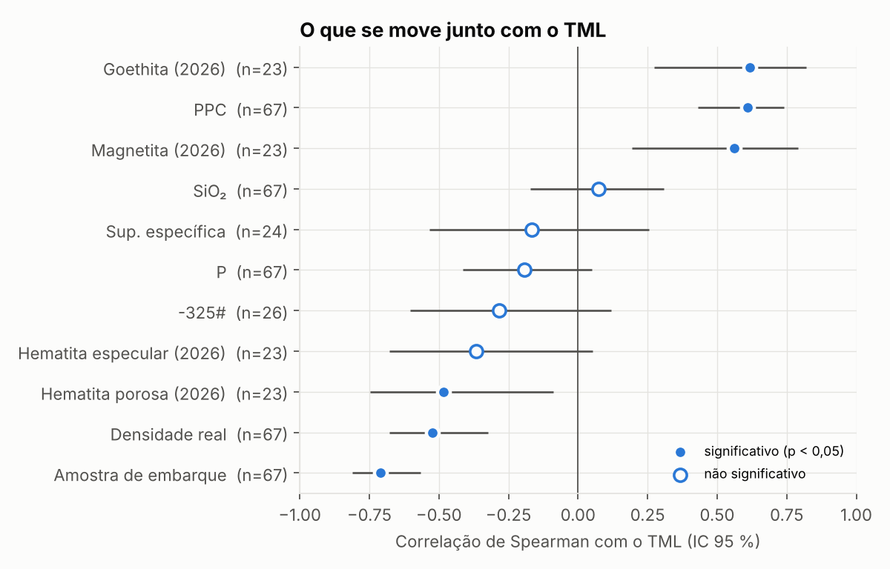
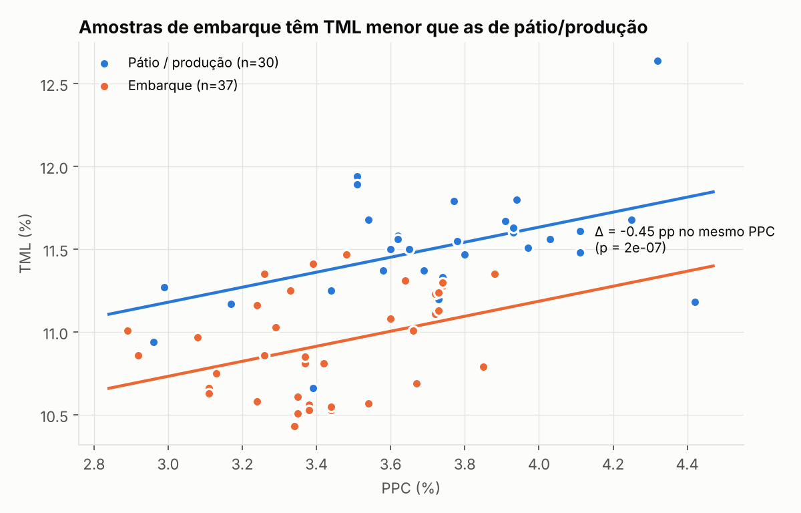
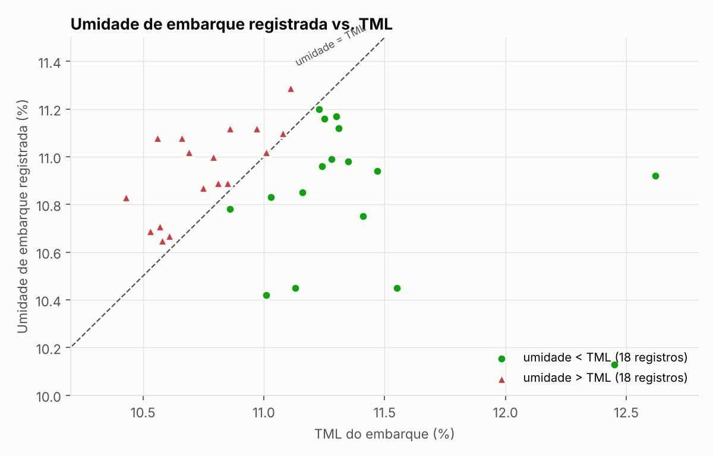
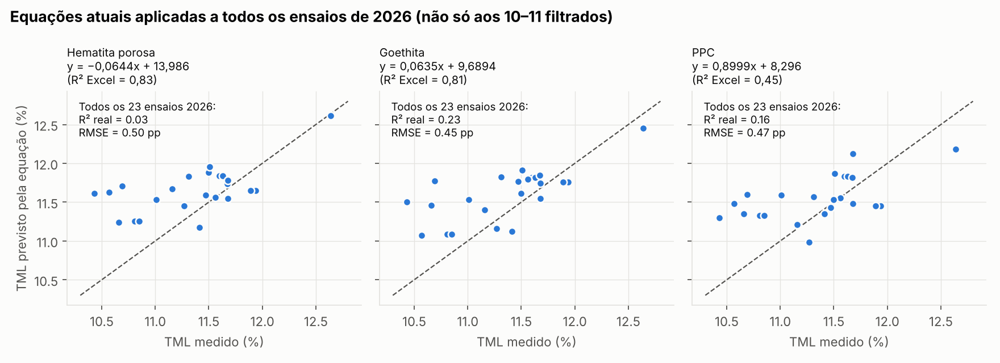
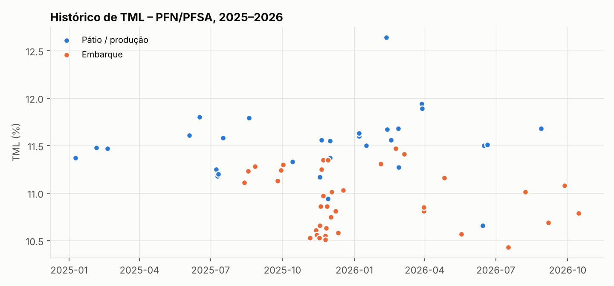
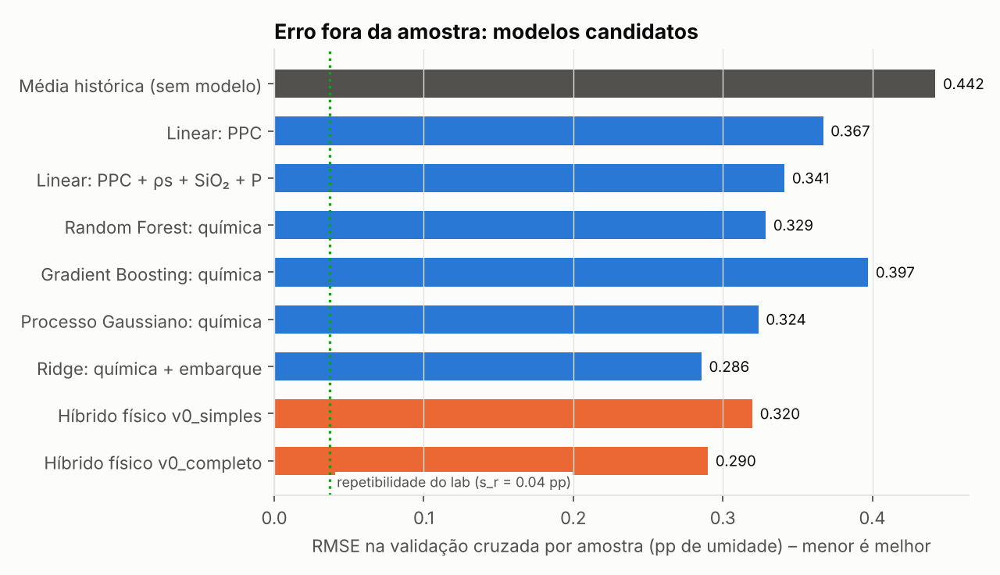
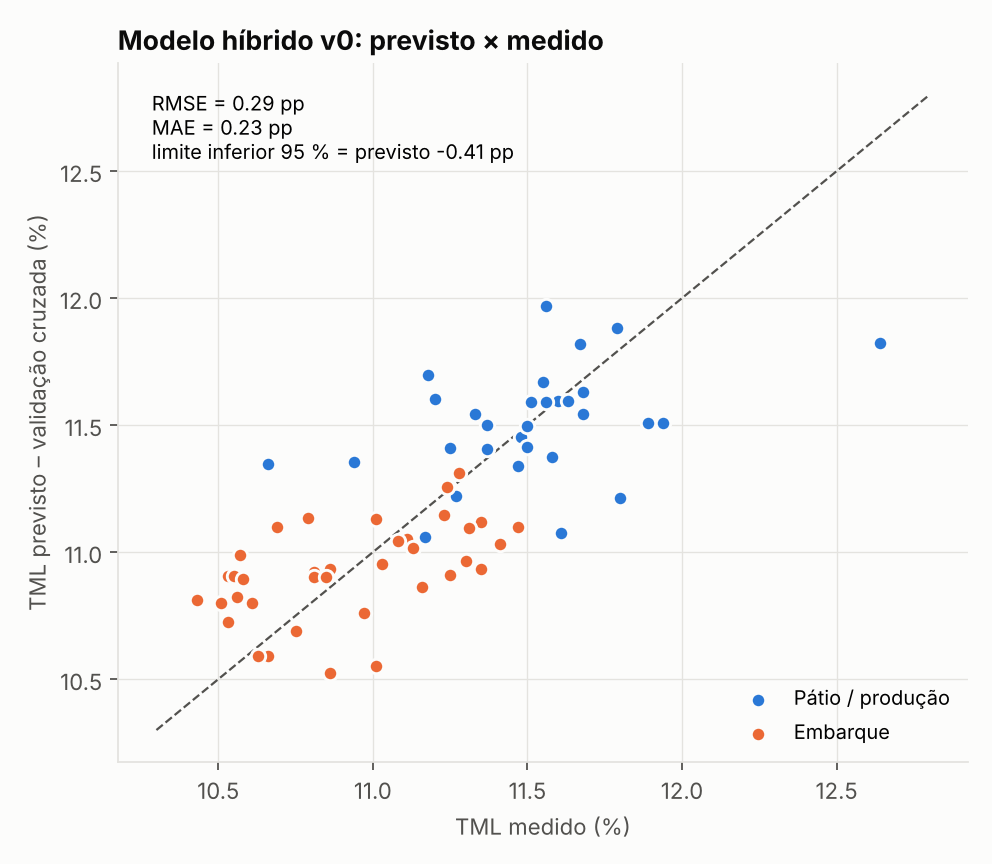

# Preditor de TML — Raio-X da base 2025–2026 e proposta de modelo

**Produto:** pellet feed (PFN, PF SA, PSC) · **Ensaio:** Proctor/Fagerberg modificado (PFD80, IMSBC Code)
**Base analisada:** `Histórico TML 2025.xlsx` e `Histórico TML 2026.xlsx` (todas as abas)
**Reprodução:** `python src/etl.py && python src/predictor.py train && python src/analysis.py`

---

## 0. Sumário executivo

1. **A base tem 70 ensaios de TML, de 63 amostras físicas.** São 61 de PFN, 7 de PF SA e 3 de PSC. Para PFN/PFSA, o TML varia de 10,43% a 12,64%, com média de 11,19% e desvio-padrão de 0,44 pp. É uma faixa estreita: o "sinal" a prever é de poucos décimos.
2. **O laboratório é muito repetível.** O desvio de repetibilidade é s_r = 0,04 pp (r95 = 0,10 pp, calculado sobre 6 pares de réplicas). O piso de erro, portanto, não é o ensaio. A exceção é o Azimuth, com dois TMLs (10,86% e 11,35%) para a mesma química, uma diferença de 0,49 pp que precisa ser explicada.
3. **Achado mais forte: amostras de embarque têm TML 0,45 pp menor** que amostras de pátio ou produção com o mesmo PPC (IC95%: −0,62 a −0,28 pp; p = 2·10⁻⁷). O efeito aparece separadamente em 2025 (−0,36) e em 2026 (−0,55). Na prática, **o TML de pátio superestima o TML do navio**.
4. **Alerta de segurança, a verificar com urgência.** Em **18 de 36 registros** com umidade de embarque, que correspondem a **17 navios**, a umidade registrada está **acima** do TML do próprio embarque. A margem mediana é de +0,01 pp e a pior é −0,52 pp. Isso é coerente com o item 3: se a carga foi planejada com o TML de pátio, ela embarca acima do TML real.
5. **As equações de regressão atuais não se sustentam fora da amostra.** Aplicadas aos 23 ensaios de 2026 que têm mineralogia, o R² cai de 0,83 para 0,03 (Hematita Porosa), de 0,81 para 0,23 (Goethita) e de 0,45 para 0,16 (PPC). Em 2025 o R² fica negativo. O motivo é que foram ajustadas em 10 ou 11 pontos filtrados.
6. **Os dados de mineralogia de 2025 e 2026 vêm de protocolos incompatíveis.** A goethita de 2025 é, em média, 56% do valor estequiométrico esperado pelo PPC; a de 2026 é 84%. Os dois anos **não podem ser misturados** num modelo de mineralogia.
7. **Modelo proposto (v0): híbrido física + estatística.** O modelo prevê o índice de vazios do ensaio (e80) e converte em TML pela equação do PFD80. O erro em validação cruzada honesta é **RMSE = 0,29 pp** e **MAE = 0,23 pp**, contra 0,44 pp sem modelo e cerca de 0,47 pp das equações atuais. O modelo entrega um **limite inferior de 95%** (TML previsto − 0,41 pp) para decisão do lado seguro.
8. **Com os dados atuais, existe um teto de precisão.** Cerca de 0,29 pp do erro não é explicado por nenhuma variável disponível, e não é ruído do laboratório (0,04 pp). Faltam as variáveis que a física e a literatura apontam como dominantes: **granulometria completa** e **a curva de compactação**. A seção 6 traz o plano de dados para chegar a algo próximo de 0,10 a 0,15 pp.

---

## 1. Raio-X da base

### 1.1 Inventário

| Aba | Conteúdo | Uso no projeto |
|---|---|---|
| Historico PFN 2025 / 2026 | registro primário dos ensaios (química, densidade, mineralogia, TML, umidade de embarque) | **fonte principal** |
| Histórico PSC 2025 / 2026 | 3 ensaios de PSC (PPC ≈ 0,25%, ρs ≈ 4,96) | fora do domínio (são poucos e de outra mineralogia) |
| Confirmações (2025) | réplicas T02 de 3 navios | usadas para medir a repetibilidade |
| Regressão Embarques / Filtrado (2026) | subconjuntos + **Superfície Específica (Blaine)** | o SE foi trazido para a base |
| Dados preditor (2025) | médias de TML por faixa de PPC | auditada (ver 1.2) |
| Planilha1 (2025) | tabela qualitativa de efeitos das variáveis | confrontada com os dados (seção 3.1) |

A base consolidada fica em `data/processed/tml_dataset.csv`, com rastreabilidade até a aba e a linha do Excel de origem.

| Variável | Disponível em |
|---|---|
| SiO₂, P, PPC, densidade real, TML | todos os 70 ensaios |
| Umidade de embarque | 36 registros |
| −325#, Superfície específica (Blaine) | só 2026 (26 e 24 ensaios) |
| Mineralogia em 4 fases (HE, HP, Mag, Goe) | só 2026 (23 ensaios) |
| Mineralogia em 2 fases (HP, Goe) | só 2025 (31 ensaios), **protocolo diferente** |
| Granulometria completa, curva de compactação, OMC, densidade seca máxima | **inexistentes** |

### 1.2 Problemas de qualidade encontrados

A lista completa, com 45 itens, está em `data/processed/data_quality.csv`. Os principais:

- **Números gravados como texto:** `'3.38'` (SiO₂, 2026 G5, G6 e Regressão Filtrado C3), `'18,77'` (Goethita, 2025 K22), `'0.065'` (P, 2025 H23 e Confirmações). O Excel **ignora** essas células em médias e linhas de tendência. No gráfico "Fósforo × TML", por exemplo, um ponto some sem aviso.
- **Aba "Dados preditor" (2025):**
  - as médias por faixa de PPC usam intervalos que deixam linhas de fora (`=AVERAGE(C4:C11)` com dados até a linha 18; `C26:C38` sem as linhas 23–24; `C42:C50` sem a 51);
  - três pares TML/PPC foram digitados nas colunas I/J;
  - a "Porosidade" da linha 50 é, na verdade, o TML (11,56);
  - SiO₂ e PPC das linhas 43–44 divergem do histórico (3,95 contra 1,47; 3,92 contra 3,69).
- **Validade:** uma linha usa `+89` dias em vez de `+179` (2025, P35).
- **Ordem cronológica:** em 2026, o ensaio de 28/08 está registrado depois do de 15/10.
- **Colunas PFUF / PM / PFSA:** os valores numéricos não têm definição na planilha. Preciso saber o que representam, porque podem ser variáveis úteis (proporção na mistura?).

---

## 2. A física do TML e o que a literatura já faz

### 2.1 Como o PFD80 define o TML

No método Proctor/Fagerberg modificado para finos de minério de ferro (IMSBC Code, Apêndice 2), o TML é a umidade em que a curva de compactação cruza a linha de **grau de saturação Sr = 80%**. Em qualquer ponto dessa linha vale:

```
w (base seca) = Sr · e · ρw / ρs              e  = índice de vazios do material compactado
TML (% base úmida) = 100 · w / (1 + w)        ρs = densidade real dos sólidos
```

**Consequência prática:** cada ensaio histórico revela o **índice de vazios efetivo e80** da amostra. Na sua base, e80 tem média de 0,739, o que equivale a uma porosidade de 42,5%. O TML é, no fundo, uma medida de **quanto espaço vazio o material deixa ao ser compactado**, corrigida pela densidade dos grãos.

Isso explica por que a densidade sozinha não basta. Se o empacotamento fosse constante, a densidade explicaria o TML com RMSE de 0,40 pp, praticamente o mesmo que não ter modelo. O que realmente varia de amostra para amostra é o **empacotamento**, que depende da granulometria, da forma e da porosidade das partículas.

### 2.2 Literatura relevante

| Referência | O que traz | Relevância para nós |
|---|---|---|
| Ferreira, Pereira & Lima (2019), *Powder Technology* 345:329-337 | primeiro modelo empírico da literatura para estimar o TML PFD80 a partir de **um único ponto de compactação** | **alta**: reduz drasticamente o tempo e a massa de ensaio; candidato a "pré-TML" rápido |
| Ferreira & Lima (2022), *Powder Technology* | o TML PFD80 é **fortemente dependente da distribuição granulométrica** | **alta**: aponta a variável que falta na base |
| *Tecnologia em Metalurgia, Materiais e Mineração* (2024), "Relationship between solids density and the PFD80 TML…" | relação entre densidade de sólidos e TML em finos hematíticos e goethíticos | confirma ρs como variável estrutural do modelo |
| *Tecnologia em Metalurgia…* (2024), "Influence of goethite on the TML of iron ore fines" | goethita correlaciona positivamente com o TML, por menor compactação, mais vazios e menor densidade | confirma o seu achado de 2026 (ρ = +0,62) |
| Munro & Mohajerani (RMIT, 2015–2017), *Marine Structures* / *Ocean Engineering* | variabilidade entre métodos de ensaio; perda de resistência abaixo do TML sob carga cíclica | justifica tratar o TML com margem e incerteza |
| ABM Proceedings: modelagem da umidade de embarque (980+ cargas; séries temporais, regressão e redes neurais) | prever a **umidade** do embarque, o outro lado da margem | complementar: preditor de TML + preditor de umidade = gestão de margem |
| ClassNK / P&I clubs (circulares sobre o PFD80) | Sr = 80%; o método só se aplica se Sr na umidade ótima (OMC) for ≥ 90% | requisito de validade a registrar em cada ensaio |

> Não consegui ler o texto completo de Ferreira et al. (2019), porque o acesso ao ScienceDirect está bloqueado nesta sessão. A equação do modelo de ponto único precisa ser obtida do artigo para ser implementada.

---

## 3. Achados

### 3.1 O que se move junto com o TML



| Variável | Sua tabela qualitativa (Planilha1) | O que os dados mostram |
|---|---|---|
| PPC | correlação | **confirmado** (ρ = +0,61, n = 67) |
| Goethita | efeito direto | **confirmado em 2026** (ρ = +0,62); em 2025 é fraco (+0,38) por causa do protocolo |
| Hematita porosa | afeta o TML | em 2026, ρ = −0,48 (**sinal negativo**: mais hematita porosa, menor TML) |
| Densidade | menor densidade, maior TML | **confirmado** (ρ = −0,52) |
| Hematita compacta / magnetita | reduzem o TML | magnetita mostrou ρ = **+0,56** em 2026, sinal oposto ao esperado; com n = 23 e teor de 1,5–3,7%, pode ser efeito indireto |
| Sílica, Ferro, −325#, Sup. específica | sem correlação | **confirmado** (nenhuma significativa) |
| Fósforo | consequência da goethita | não significativo (ρ = −0,19) |
| **Tipo de amostra (embarque)** | não estava na tabela | **é a variável mais forte** (ρ = −0,70) |

### 3.2 Embarque × pátio/produção: −0,45 pp



Mesmo controlando por PPC, densidade, SiO₂ e produto, as amostras de navio têm TML cerca de 0,45 pp menor. Com erros agrupados por amostra, p = 2·10⁻⁷, e o efeito aparece nos dois anos de forma independente. Como o efeito pertence ao **e80** (o empacotamento), e não à química, as hipóteses físicas são:

1. **Degradação ou segregação no manuseio** (empilhamento, retomada, correias, carregamento). Isso muda a granulometria e o empacotamento da amostra do navio.
2. **Composição da amostra:** a amostra de embarque é uma composta de muitos incrementos, enquanto a de pátio ou produção é mais "pontual".
3. **Diferença de procedimento:** outro laboratório, operador, tempo entre coleta e ensaio, ou secagem prévia.
4. **Uso de desidratante:** nos pares de 2025 (KSL Sydney, Azimuth com e sem), o efeito é pequeno e inconsistente. Não explica o −0,45 pp.

**Recomendação:** um experimento controlado, com a mesma pilha ensaiada como amostra de pátio e como amostra de embarque, no mesmo laboratório, com granulometria a laser nas duas, para isolar a causa.

### 3.3 Segurança: umidade de embarque × TML



Dos 36 registros com umidade de embarque, **18 (17 navios) têm umidade registrada acima do TML**: 10 de 23 em 2025 e 8 de 13 em 2026. Antes de qualquer conclusão, é preciso confirmar:
- se a "Umidade Embarque" e o TML estão na mesma base (úmida);
- em que ponto a umidade é medida (média do navio, porões, momento) e se o TML usado no certificado é o mesmo da planilha;
- o efeito do desidratante na umidade final.

Se os números se confirmarem, este é o principal resultado prático do projeto: **o preditor deve ser usado com o limite inferior e com o tipo de amostra "embarque"**, nunca com o TML de pátio.

### 3.4 As equações atuais fora da amostra



As equações foram ajustadas na aba "Regressão Filtrado", com 10 ou 11 pontos sem navios. Quando aplicadas a todos os ensaios de 2026, viram uma linha quase horizontal e superestimam o TML em 0,2 a 0,3 pp, justamente por não considerar o efeito de embarque. O ponto de 12,64% (pátio A, 17/01, goethita 43,6%) sustenta a maior parte do R² original.

> Nota regulatória: com goethita de 43,6%, vale checar se a amostra ainda se enquadra na ficha "Iron Ore Fines" do IMSBC, que tem um critério de goethita total.

### 3.5 Linha do tempo



O 4º trimestre de 2025 concentra TMLs baixos (média 10,95%). A explicação é PPC baixo (3,36%) somado à predominância de amostras de embarque. Em 2026, o resíduo do modelo cai do 1º trimestre (+0,32) para o 3º (−0,31). Vale acompanhar se há mudança de minério ou de procedimento no laboratório.

---

## 4. Modelo v0: híbrido física + estatística

### 4.1 Estrutura

```
1) Camada estatística   e80 = 0,7783 + 0,0349·PPC − 0,0019·ρs − 0,0080·SiO₂ − 1,9672·P − 0,0294·Embarque
2) Camada física (PFD80) w = 0,80 · e80 / ρs
                         TML (%) = 100 · w / (1 + w)
3) Decisão               TML_seguro = TML_previsto − 0,41 pp   (limite inferior unilateral de 95 %)
```

`Embarque` vale 1 para amostra de navio e 0 para pátio ou produção. Os coeficientes são re-estimados automaticamente com `python src/predictor.py train`. Existe também a versão `v0_simples` (só PPC e Embarque), com RMSE de 0,32 pp, para quando só o PPC estiver disponível.

**Por que híbrido?** Com as variáveis de hoje, o modelo híbrido e a regressão direta empatam em erro. A estrutura física, porém:
1. garante o comportamento correto em ρs (TML ∝ 1/ρs no mesmo empacotamento), inclusive fora da faixa de treino;
2. aprende uma grandeza física (e80) que pode ser **medida diretamente** no ensaio de compactação. É a ponte para a v1, que usará granulometria e curva de compactação;
3. é auditável: dá para mostrar a equação a cliente, auditor ou autoridade.

### 4.2 Desempenho: validação cruzada por amostra (réplicas nunca separadas)



| Modelo | RMSE (pp) | MAE (pp) | % com erro ≤ 0,3 pp |
|---|---|---|---|
| Média histórica (sem modelo) | 0,442 | 0,360 | 43% |
| Linear: PPC | 0,367 | 0,294 | 61% |
| Linear: PPC + ρs + SiO₂ + P | 0,341 | 0,276 | 60% |
| Random Forest (química) | 0,329 | 0,253 | 72% |
| Gradient Boosting (química) | 0,397 | 0,304 | 58% |
| Processo Gaussiano (química) | 0,324 | 0,262 | 66% |
| Ridge: química + embarque | 0,286 | 0,219 | 66% |
| **Híbrido físico v0_completo** | **0,290** | **0,227** | **64%** |



Leitura dos resultados:
- **Machine learning "pesado" (Random Forest, Gradient Boosting) não ganha** com n = 67. O Gradient Boosting é pior que uma reta. Com essa base, o ganho vem das **variáveis certas** (o tipo de amostra), não de algoritmos mais complexos.
- O maior erro do v0 é a amostra de 12,64%, prevista em 11,82%, a mais goethítica da base. A mineralogia de 2026 ajuda nesse caso, mas com só 23 pontos ainda não é estável o bastante para entrar no modelo geral.

### 4.3 Como usar hoje

```bash
python src/predictor.py predict --ppc 3.60 --rho 4.690 --sio2 2.10 --p 0.061 --embarque 1
# TML previsto            : 11.06 %
# Limite inferior (95 %)  : 10.65 %   <- usar para decisão
# Intervalo 95 %          : 10.61 – 11.61 %
```

O preditor avisa quando a entrada está fora da faixa de treino (PPC 2,89–4,42; ρs 4,51–4,78; SiO₂ 1,47–4,88).

**Escopo:** o preditor serve para triagem, controle de processo, planejamento de pilha e embarque, e para escolher quando reensaiar. **Ele não substitui o ensaio PFD80 oficial** exigido pelo IMSBC Code para o certificado.

---

## 5. Onde está o limite com os dados atuais

| Fonte de variação | Magnitude (pp) |
|---|---|
| Variação total do TML (PFN/PFSA) | 0,44 |
| Erro do melhor modelo com os dados atuais | 0,29 |
| Repetibilidade do laboratório | 0,04 |
| **Não explicado e não ruído (variáveis faltantes)** | **≈ 0,29** |

O erro restante quase todo é **sinal físico não medido**. A física do PFD80 e a literatura (Ferreira & Lima, 2022) indicam qual é: a **distribuição granulométrica**, que governa o empacotamento (e80), e o **comportamento de compactação** de cada amostra.

---

## 6. Roteiro para um preditor moderno e muito preciso

### Fase A: governança de dados (imediata, custo baixo)
- Substituir as planilhas por uma **tabela única de ensaios** (um ensaio por linha), com: ID da amostra, **tipo de amostra** (navio / pátio / produção / alimentação), ponto de coleta, data de coleta **e** de ensaio, laboratório, operador, produto, desidratante (sim/não, dose), réplica (T01/T02).
- Gravar números como números, padronizar o protocolo de mineralogia (manter o de 2026, que fecha em cerca de 97%) e **guardar todos os pontos da curva de compactação** do PFD80 (umidade × densidade seca, 5 a 6 pontos), além de Sr na OMC (critério de validade ≥ 90%).
- Definir as colunas PFUF / PM / PFSA.

### Fase B: novas medições em cada amostra de TML (o maior ganho de precisão)
1. **Granulometria a laser completa:** D10, D50, D90, % < 10 µm, % < 45 µm, span. É a variável que, pela literatura, mais pesa no PFD80.
2. **Curva de compactação completa:** densidade seca máxima e OMC. Com elas, o e80 é quase medido diretamente.
3. **BET / porosimetria** em parte das amostras, para conectar hematita porosa e goethita à água retida nos poros.
4. **Mineralogia em 4 fases** (protocolo de 2026) em todos os ensaios.

Meta de base: **150 a 200 ensaios** com esse pacote completo. No ritmo atual (cerca de 35 ensaios por ano), isso levaria anos. Por isso é preciso um **plano de ensaios dedicado**: reensaiar amostras de arquivo, montar misturas planejadas que cubram a faixa de PPC, goethita e granulometria (desenho de experimentos) e usar o modelo de ponto único para baratear cada ponto.

### Fase C: modelo v1
- **Modelo de empacotamento** (por exemplo, Andreasen ou o Modelo de Empacotamento Compressível) para prever e80 a partir da granulometria, com correção pela porosidade das partículas (goethita e hematita porosa).
- **Processo Gaussiano com média física** (*physics-informed*): a equação do PFD80 é a média e o GP aprende o desvio. Isso dá incerteza calibrada por amostra.
- **Hierarquia por produto e por tipo de amostra**, que permite incorporar PSC e novos produtos com poucos dados.
- Implementação do **modelo de ponto único de Ferreira et al. (2019)** como "TML rápido": um único ponto de compactação já estima o TML.

### Fase D: operação
- **Gestão de margem:** acoplar este preditor a um preditor de **umidade de embarque**, como na abordagem ABM, e monitorar `margem = TML_seguro − umidade_prevista` por lote e por navio.
- Monitoramento contínuo: cada novo ensaio oficial vira um ponto de validação; o modelo é recalibrado mensalmente e alerta quando aparecer deriva (como a do 1º para o 3º trimestre de 2026).
- Interface: planilha ou web app (Streamlit) para o laboratório e o planejamento.

---

## 7. Próximas ações recomendadas (em ordem)

1. **Verificar os 17 navios com umidade registrada acima do TML** (seção 3.3).
2. **Esclarecer o par Azimuth** (10,86% × 11,35% "ofc"): é o mesmo material em laboratórios diferentes?
3. **Experimento embarque × pátio** com granulometria a laser (seção 3.2).
4. Implantar a Fase A já nos próximos ensaios.
5. Adotar o v0 (com limite inferior) como ferramenta de triagem e comparar com cada novo ensaio oficial.

---

## Fontes

- [Ferreira, Pereira & Lima (2019). A model for estimating the PFD80 transportable moisture limit of iron ore fines. *Powder Technology* 345](https://www.sciencedirect.com/science/article/abs/pii/S0032591019300245) · [repositório UFOP](https://monog.ufop.br/items/332cb156-faba-443c-9f7e-b09d50cfb6c2)
- [Aplicação de um modelo para estimativa do TML PFD80 de finos de minério de ferro (ResearchGate)](https://www.researchgate.net/publication/337937733_APLICACAO_DE_UM_MODELO_PARA_ESTIMATIVA_DO_TML_PFD80_DE_FINOS_DE_MINERIO_DE_FERRO) · [OneMine](https://onemine.org/documents/using-a-model-for-estimating-the-pfd80-tml-of-iron-ore-fines)
- [Relationship between particle size distribution and the PFD80 TML of iron ore fines. *Powder Technology* (2022)](https://www.sciencedirect.com/science/article/abs/pii/S0032591022009536)
- [Relationship between solids density and the PFD80 TML of hematite-rich and goethite-rich iron ore fines (Tecnologia em Metalurgia, Materiais e Mineração)](https://tecnologiammm.com.br/article/doi/10.4322/2176-1523.20243093)
- [Influence of goethite on the Transportable Moisture Limit of iron ore fines (Tecnologia em Metalurgia, Materiais e Mineração)](https://tecnologiammm.com.br/article/doi/10.4322/2176-1523.20243070)
- [Munro & Mohajerani: Determination of the TML of iron ore fines (resumo)](https://atcwilliams.com/resources-archive/determination-of-the-transportable-moisture-limit-of-iron-ore-fines-for-the-prevention-of-liquefaction-in-bulk-carriers/) · [Moisture content limits of IOF – review](https://atcwilliams.com/resources-archive/moisture-content-limits-of-iron-ore-fines-to-prevent-liquefaction-during-transport-review-and-experimental-study/) · [Review of the newly developed method (Australian Geomechanics)](https://australiangeomechanics.org/papers/a-review-of-the-newly-developed-method-used-to-prevent-liquefaction-of-iron-ore-fines-on-bulk-carriers)
- [Maritime Bulk Cargo TML Requirements for Iron Ore Shipments (ResearchGate)](https://www.researchgate.net/publication/317953835_Maritime_Bulk_Cargo_Transportable_Moisture_Limit_Requirements_for_Iron_Ore_Shipments)
- [ABM Proceedings: Modelagem da umidade dos embarques de produtos de minério de ferro fino](https://abmproceedings.com.br/en/article/modelagem-da-umidade-dos-embarques-de-produtos-de-minrio-de-ferro-fino-para-auxiliar-no-controle-e-gesto-de-riscos-ao-tml-limite-de-umidade-transportvel)
- [ClassNK: Carriage and testing of Iron Ore Fines](https://www.classnk.com/hp/pdf/tech_info/tech_img/T987e.pdf) · [Britannia P&I: IMSBC Code iron ore fines](https://britanniapandi.com/wp-content/uploads/2025/03/IMSBC-Code-carriage-and-testing-of-iron-ore-fines-Australia-01-2014.pdf) · [Skuld circular](https://www.skuld.com/contentassets/97a6e45d7c054d29b3aa6d90057e5d77/non-class-anb-circular.pdf) · [Nautical Institute](https://www.nautinst.org/static/uploaded/640199eb-52d4-40b7-8d3ad71d4a19ceda.pdf)
